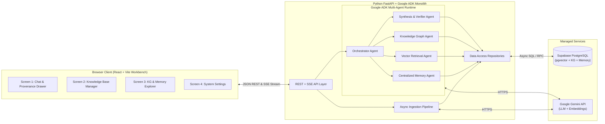
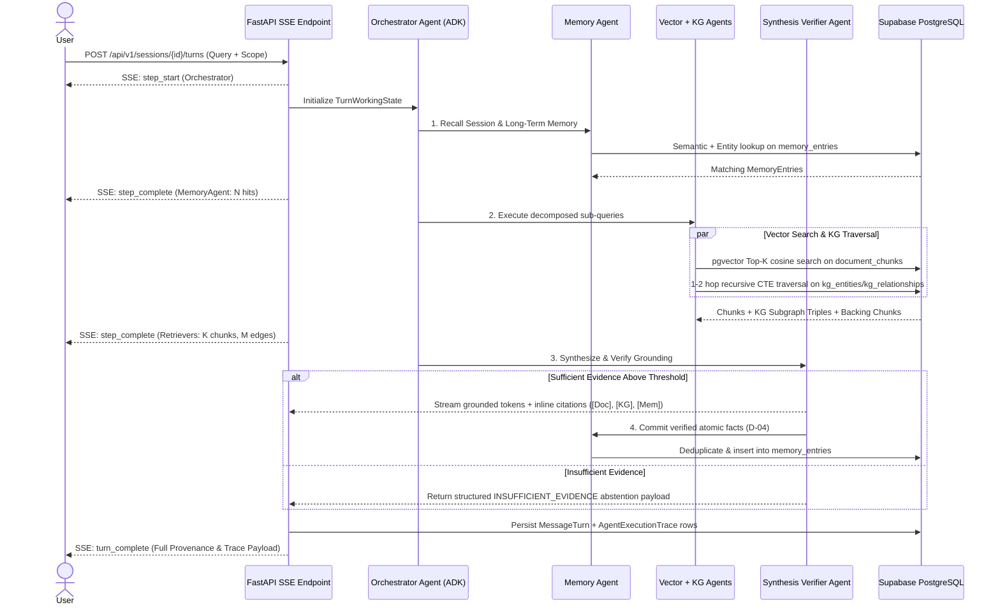

# System Architecture Specification (ARCHITECTURE.md)
**Product:** Agentic RAG System with Centralized Memory and Knowledge Graph  
**Version:** 1.0.0  
**Status:** Approved Baseline — Source of Truth for Engineering Implementation  
**References:** Paired with `PRD.md` (v1.0.0) and `DESIGN.md` (v1.0.0)

---

## 1. Recommended Tech Stack & Reasoning

To honor the rule of choosing the **simplest reliable architecture** without unnecessary microservices or operational bloat, the system uses a **Modular Monolith** pattern: one Python backend service hosting both the API and the Google ADK agent runtime, one lightweight React frontend workbench, and one unified **Supabase PostgreSQL** database handling relational records, `pgvector` embeddings, Knowledge Graph adjacency tables, and Centralized Memory.

| Layer | Technology Choice | Reasoning & Fit for MVP |
| :--- | :--- | :--- |
| **Agent Orchestration** | **Google ADK (`google-adk`, Python 3.11+)** | Approved in `D-01`. Provides native primitives for hierarchical multi-agent delegation (`LlmAgent`, `SequentialAgent`, `ParallelAgent`), structured tool invocation, and shared session state (`InvocationContext` / `SessionService`). |
| **LLM & Embeddings** | **Google Gemini API (`google-genai`)** | `gemini-2.5-flash` delivers low-latency structured output for schema-guided Knowledge Graph extraction, query decomposition, and grounded synthesis. `text-embedding-004` (768-dim) provides high-precision embeddings for chunks, entities, and memories. |
| **Backend API & Worker** | **FastAPI + Uvicorn (Async Python)** | Native async support for Server-Sent Events (SSE) to stream Google ADK agent step transitions (`< 500ms` TTFS) and built-in `BackgroundTasks` for non-blocking document ingestion without requiring Redis/Celery in MVP. |
| **Database, Vector & KG Store** | **Supabase PostgreSQL (`pgvector`)** | Approved in `D-02`. Eliminates multi-database synchronization bugs by storing documents, vector chunks, Knowledge Graph nodes/edges, centralized memories, and execution traces in a single ACID-compliant transactional store. |
| **Database Client / Access** | **`asyncpg` / SQLAlchemy 2.0 (Async) or Supabase Python SDK** | Enables parameterized queries, transactional writes for memory deduplication, HNSW vector similarity queries, and recursive CTE queries for 1–2 hop Knowledge Graph traversal. |
| **Document Parsing** | **`PyMuPDF` (`fitz`) + Native Python Text/Markdown Splitter** | Fast, zero-external-API local text extraction for `.pdf`, `.md`, and `.txt` files with exact page number and character offset tracking. |
| **Frontend Workbench** | **React 19 + TypeScript + Vite + Tailwind CSS v4** | Matches the 4-screen single-page workbench in `DESIGN.md` without the complexity of SSR frameworks. Provides fast client-side state transitions for the 3-pane Provenance Inspector. |
| **2D Subgraph Visualization** | **`react-force-graph-2d` or `@xyflow/react` (React Flow)** | Lightweight 2D node-link rendering for bounded 1–2 hop local subgraphs (`<= 25` nodes), paired with semantic HTML list views for accessibility (`DESIGN.md 4.4`). |

---

## 2. Frontend & Backend Architecture

### 2.1 High-Level System Topology (Modular Monolith)


### 2.2 Frontend Architecture
- **App Shell & State Management:**
  - Uses a lightweight global store (React Context or Zustand) for **Active Role (`Researcher` vs. `Knowledge Admin`)**, **Active Session ID**, **Memory Scope Toggle**, and **Selected Citation/Inspector Target**.
  - **Server State & Caching:** Standard fetch hooks manage document tables, KG entity lists, and memory registries, polling document status (`QUEUED` → `INDEXED`) only while active ingestion jobs exist.
  - **SSE Stream Consumer:** A dedicated stream reader processes server-sent events during chat turns, updating the **Live Agent Activity Stepper** (`DESIGN.md 4.2`) in real time and appending streamed synthesis tokens to the active turn.
  - **Cross-Highlighting Engine:** Maps inline citation buttons (`[Doc: #]`, `[KG: #]`, `[Mem: #]`) directly to pre-loaded evidence objects returned in the turn metadata payload so clicking any citation opens the Right Provenance Inspector instantaneously (`0ms` network wait).

### 2.3 Backend Architecture
The backend is organized into four clean internal layers with strict one-way dependency rules (`API -> Services/Agents -> Repositories -> Database`):
1. **Transport / API Layer:** Handles HTTP routing, request validation (Pydantic), role permission guards, and SSE stream formatting.
2. **Ingestion Service Layer:** Executes deterministic text chunking, SHA-256 content hashing, batch embedding requests, schema-guided LLM entity/relation extraction, and canonical entity resolution inside background workers.
3. **Google ADK Agent Layer:** Houses the 5 specialized agents, their tool definitions, system instructions, and the shared `TurnWorkingState` contract.
4. **Repository / Persistence Layer:** Encapsulates all SQL, `pgvector` cosine distance queries, and recursive graph traversal queries against Supabase PostgreSQL.

---

## 3. End-to-End Data Flows

### 3.1 Flow 1: Document Ingestion & Knowledge Graph Construction
1. **Upload & Validation:** Admin uploads a `.pdf`, `.md`, or `.txt` file (`<= 25 MB`). API computes the `SHA-256` hash (`NFR-06`). If an indexed document with the same hash exists, the API returns existing metadata (or replaces it if `re_index=true`).
2. **Queued Record Creation:** Backend inserts a `documents` row with `status = 'QUEUED'`, returns `202 Accepted` to the UI, and dispatches an async background task.
3. **Deterministic Chunking (`status = 'CHUNKING'`):** Parser extracts text with page numbers and character offsets, splitting into deterministic chunks (`512–1000` tokens, `100` token overlap). Batch embeddings are generated via Gemini Embedding API and stored in `document_chunks`.
4. **Schema-Guided KG Extraction (`status = 'EXTRACTING_KG'`):** For each chunk (batched concurrently with rate-limit semaphores), Gemini extracts structured JSON containing candidate entities and directed relationships constrained to the approved schema (`D-03`).
5. **Entity Canonicalization & Graph Commit:**
   - Candidate entity names are normalized (trimmed, lowercased lookup key, alias matched) and resolved against existing `kg_entities` rows.
   - New or updated `kg_entities` and `kg_relationships` rows are committed with `source_chunk_id` and `document_id` foreign keys (`FR-15`).
6. **Completion (`status = 'INDEXED'`):** Document status transitions to `INDEXED` (or `FAILED` with `error_message` on unrecoverable error).

### 3.2 Flow 2: Collaborative Multi-Agent Query & Grounded Synthesis


---

## 4. Folder Structure

The project uses a clean monorepo layout inside `/home/drona/Documents/GitHub/ADK_Learning/Project/adk_rag` separating the Python ADK backend, React frontend, and Supabase database migrations:

```text
adk_rag/
├── PRD.md                          # Product Requirements (Source of Truth)
├── DESIGN.md                       # UX/UI Design System (Source of Truth)
├── ARCHITECTURE.md                 # System Architecture (Source of Truth)
├── .env.example                    # Template for required environment variables
├── README.md                       # Setup, migration, and run instructions
│
├── supabase/
│   ├── migrations/
│   │   └── 0001_initial_schema.sql # pgvector extension, tables, HNSW indexes, KG CTE functions
│   └── seed.sql                    # Default system settings and sample seed data
│
├── backend/
│   ├── pyproject.toml              # Python dependencies (google-adk, fastapi, asyncpg, pymupdf, etc.)
│   ├── app/
│   │   ├── main.py                 # FastAPI app entry point, CORS, lifespan pool initialization
│   │   ├── config.py               # Validated environment & runtime settings
│   │   ├── api/
│   │   │   ├── deps.py             # Role header verification & DB session dependencies
│   │   │   ├── routes_chat.py      # Session CRUD & SSE multi-agent query endpoint
│   │   │   ├── routes_kb.py        # Document upload, status, chunk inspection, deletion
│   │   │   ├── routes_explorer.py  # KG subgraph search & Centralized Memory CRUD
│   │   │   └── routes_settings.py  # System retrieval settings & health telemetry
│   │   ├── agents/                 # Google ADK Multi-Agent Definitions
│   │   │   ├── state.py            # Typed TurnWorkingState contract (FR-06)
│   │   │   ├── orchestrator.py     # Root Coordinator Agent & loop circuit breaker
│   │   │   ├── vector_agent.py     # Document Chunk Retrieval Agent & tools
│   │   │   ├── kg_agent.py         # Knowledge Graph Traversal Agent & tools
│   │   │   ├── memory_agent.py     # Centralized Memory Recall & Verified-Write Agent
│   │   │   └── synthesis_agent.py  # Grounding Verifier & Citation Enforcer Agent
│   │   ├── services/
│   │   │   ├── ingestion.py        # Chunking, embedding, and KG extraction pipeline
│   │   │   ├── kg_extractor.py     # Schema-guided entity/relation extraction & canonicalization
│   │   │   └── trace_logger.py     # Step-by-step AgentExecutionTrace recorder
│   │   ├── repositories/
│   │   │   ├── document_repo.py    # Document & chunk vector queries
│   │   │   ├── kg_repo.py          # Entity resolution, 1-2 hop traversal, cascading cleanup
│   │   │   ├── memory_repo.py      # Working, session, and long-term memory persistence
│   │   │   └── session_repo.py     # Conversation sessions, turns, and trace persistence
│   │   └── schemas/                # Pydantic API request/response & SSE event models
│   └── tests/
│       ├── unit/                   # Chunker, canonicalizer, citation parser tests
│       └── integration/            # Multi-hop KG, memory reuse, and abstention verification suites
│
└── frontend/
    ├── package.json
    ├── vite.config.ts
    └── src/
        ├── main.tsx
        ├── App.tsx                 # App Shell + Top Global Utility Bar + Screen Router
        ├── types/                  # TypeScript interfaces matching backend Pydantic schemas
        ├── api/                    # REST client & SSE stream consumer hooks
        ├── store/                  # Role, active session, and Provenance Inspector state
        ├── components/             # Reusable Design System primitives (DESIGN.md Section 4)
        │   ├── citations/          # CitationBadge, VerbatimEvidenceCard, AbstentionCard
        │   ├── trace/              # LiveAgentStepper, ExecutionTraceTimeline
        │   ├── graph/              # KGPathList, LocalSubgraphCanvas
        │   └── memory/             # MemoryEntryCard, MemoryScopeToggle
        └── screens/                # 4 Core MVP Screens (DESIGN.md Section 10)
            ├── ResearchWorkspace.tsx
            ├── KnowledgeBaseManager.tsx
            ├── GraphMemoryExplorer.tsx
            └── SystemSettings.tsx
```

---

## 5. Database Interaction (Supabase PostgreSQL)

### 5.1 Extensions & Core Tables
The Supabase PostgreSQL instance enables `vector` (`pgvector`) and `pgcrypto` (for UUID generation) and implements 8 core tables aligned with `PRD.md Section 7`:
1. `system_settings`: Single-row configuration table storing adjustable runtime parameters (`top_k_chunks`, `similarity_threshold`, `max_kg_hops`, `max_agent_steps`, `auto_consolidate_memory`).
2. `documents`: Tracks uploaded file metadata, `content_hash` (unique index for idempotency), pipeline `status`, and counts.
3. `document_chunks`: Stores chunk text, `metadata` (`JSONB`), and `embedding` (`vector(768)`).
4. `kg_entities`: Stores canonical entities (`canonical_name`, `lookup_key` unique index, `entity_type`, `aliases` text array, `description`, `embedding` `vector(768)`, and `source_chunk_ids` UUID array).
5. `kg_relationships`: Directed edges (`source_entity_id`, `target_entity_id`, `relation_type`, `evidence_snippet`, `confidence`, `source_chunk_id` FK with `ON DELETE CASCADE`, `document_id` FK with `ON DELETE CASCADE`).
6. `conversation_sessions`: Session metadata and `use_shared_memory` flag.
7. `message_turns`: User query, assistant response, structured `citations` (`JSONB`), and `grounding_status`.
8. `memory_entries`: Unified Centralized Memory table storing `memory_tier` (`SESSION`, `LONG_TERM_SEMANTIC`, `LONG_TERM_EPISODIC`), `content`, `embedding` (`vector(768)`), `related_entities` UUID array, `source_turn_id`, `supporting_chunk_ids`, and `superseded_by_id` (self-referencing FK).
9. `agent_execution_traces`: Immutable step logs linked to `turn_id`.

### 5.2 Indexing & Query Strategy
- **Vector Similarity Indexes:** HNSW indexes (`vector_cosine_ops`) on `document_chunks.embedding`, `kg_entities.embedding`, and `memory_entries.embedding` for sub-50ms top-K nearest-neighbor search.
- **1–2 Hop Knowledge Graph Traversal:** Implemented via an indexed SQL query / PostgreSQL function (`traverse_kg_subgraph(seed_entity_ids UUID[], max_hops INT)`) that uses a bounded recursive Common Table Expression (CTE) with cycle detection (`path_ids` array check) to return all connected nodes, edges, and their backing `source_chunk_id`s in a single database round-trip.
- **Cascading Document Deletion (`FR-16`):**
  - Deleting a row in `documents` automatically cascades to `document_chunks` and `kg_relationships` via PostgreSQL foreign key constraints.
  - A cleanup query removes any `document_id`/`chunk_id` references from `kg_entities.source_chunk_ids` and deletes orphaned `kg_entities` where `cardinality(source_chunk_ids) = 0`.

---

## 6. Authentication & Authorization

Per `[APPROVED D-05]`, the MVP avoids heavy identity provider setup in favor of a deterministic **Lightweight Role Selector + API Key Verification** model:
- **Client-Side Role Selection:** The top utility bar provides a Role Selector (`Researcher` vs. `Knowledge Admin`). Switching roles updates the `X-App-Role` request header (`researcher` or `admin`).
- **Admin Action Protection:**
  - Read and research endpoints (`GET` endpoints, session creation, chat query execution, session-only memory deletion) are accessible to both `researcher` and `admin`.
  - Mutating administrative endpoints (document upload/delete/re-index, global shared memory deletion, and system settings updates) validate `X-App-Role: admin` **and** verify an optional `X-Admin-Api-Key` header against the backend `ADMIN_API_KEY` environment variable if configured.
- **Internal Agent Write Guard (`[APPROVED D-04]`):** Long-term shared memory table inserts/updates are restricted at the service layer exclusively to the `MemoryAgent` post-verification workflow and explicit Admin curation calls.

---

## 7. API Architecture

All endpoints are prefixed with `/api/v1` and return standard JSON envelopes, except the chat turn execution endpoint which streams Server-Sent Events (`text/event-stream`).

### 7.1 REST & SSE Endpoints
| Method & Path | Role Required | Description |
| :--- | :--- | :--- |
| `POST /api/v1/documents/upload` | `Admin` | Multipart upload (`.pdf`, `.md`, `.txt`). Computes SHA-256 and starts async ingestion. |
| `GET /api/v1/documents` | `Any` | Lists all documents with status, chunk counts, entity counts, and relation counts. |
| `GET /api/v1/documents/{doc_id}/chunks` | `Any` | Lists deterministic chunks and extracted KG triples for the Slide-Over Chunk Inspector. |
| `POST /api/v1/documents/{doc_id}/reindex` | `Admin` | Purges existing chunks/edges for the document and re-runs the ingestion pipeline. |
| `DELETE /api/v1/documents/{doc_id}` | `Admin` | Cascading deletion of document, chunks, and orphaned KG edges/entities (`FR-16`). |
| `POST /api/v1/sessions` | `Any` | Creates a new `ConversationSession` with `use_shared_memory` setting. |
| `GET /api/v1/sessions` | `Any` | Lists recent research sessions for the Left Context Rail. |
| `GET /api/v1/sessions/{session_id}` | `Any` | Returns full turn history, inline citation payloads, and execution traces for a session. |
| `POST /api/v1/sessions/{session_id}/turns` | `Any` | **SSE Streaming Endpoint:** Executes the 5-agent workflow and streams live events. |
| `GET /api/v1/kg/entities` | `Any` | Search/filter canonical KG entities by name, alias, or `entity_type`. |
| `GET /api/v1/kg/entities/{entity_id}/subgraph` | `Any` | Returns 1–2 hop neighborhood (nodes, edges, and backing verbatim chunks). |
| `GET /api/v1/memories` | `Any` | Lists `MemoryEntry` records filtered by tier (`SESSION`, `LONG_TERM_*`), search query, or superseded status. |
| `DELETE /api/v1/memories/{memory_id}` | `Admin` (or own session) | Deletes/forgets a specific memory record (`FR-11`). |
| `GET /api/v1/settings` | `Any` | Returns current retrieval parameters and live infrastructure health status (`Screen 4`). |
| `PUT /api/v1/settings` | `Admin` | Updates runtime retrieval and agent bounds (`Top-K`, threshold, max hops, max steps). |

### 7.2 SSE Event Stream Contract (`POST /api/v1/sessions/{session_id}/turns`)
The SSE stream emits typed event frames so the frontend can drive the **Live Agent Activity Stepper** and stream tokens without polling:
- `event: agent_step` — Emitted when an agent starts or completes (`{ step_order, agent_name, status, summary, latency_ms }`).
- `event: token` — Emitted as the Synthesis Agent streams verified response markdown (`{ delta }`).
- `event: turn_complete` — Final frame delivering the persisted `turn_id`, `grounding_status`, resolved `citations` map (`chunks`, `kg_paths`, `memories`), and full `agent_execution_traces` array.
- `event: error` — Structured error frame if an unrecoverable failure occurs.

---

## 8. External Services

| Service | Integration Purpose | Connection Protocol & Resilience |
| :--- | :--- | :--- |
| **Google Gemini API** | LLM reasoning (`gemini-2.5-flash`) for ADK agents & KG extraction; Vector generation (`text-embedding-004`). | HTTPS via official `google-genai` / `google-adk` SDKs. Configured with `15s` per-call timeout and exponential backoff (max 2 retries on `429`/`503`). |
| **Supabase PostgreSQL** | Primary persistence for relational data, `pgvector` embeddings, Knowledge Graph tables, and Centralized Memory. | Async TCP connection pool (`asyncpg` / SQLAlchemy async pool, `min_size=2`, `max_size=10`) with SSL required. |

---

## 9. AI & Multi-Agent Architecture

### 9.1 Google ADK Agent Hierarchy & Responsibilities
The system implements a deterministic, bounded multi-agent workflow orchestrated via **Google ADK**:

1. **Orchestrator Agent (`Root Coordinator`):**
   - Inspects user query and active session state.
   - Invokes `MemoryAgent` first to load prior session context and relevant shared long-term facts.
   - Decomposes complex or multi-part questions into targeted sub-queries.
   - Invokes `VectorRetrievalAgent` and `KnowledgeGraphAgent` in parallel (or sequentially if hop seeds depend on initial lookup).
   - Enforces the hard loop circuit breaker (`max_agent_steps <= 5`, `timeout <= 30s` per `NFR-03`).
2. **Centralized Memory Agent (`MemoryAgent`):**
   - **Pre-Synthesis Recall:** Queries `memory_entries` by vector similarity (`pgvector`) and entity overlap across active `SESSION` and (if enabled) `LONG_TERM_SEMANTIC` / `LONG_TERM_EPISODIC` tiers.
   - **Post-Synthesis Consolidation (`[APPROVED D-04]`):** Only when `grounding_status == 'GROUNDED'`, extracts atomic verified facts from the synthesized response, checks existing memories for semantic duplicates/conflicts (`similarity > 0.88`), marks superseded entries (`superseded_by_id`), and commits new memory records with full chunk provenance.
3. **Vector Retrieval Agent (`VectorRetrievalAgent`):**
   - Embeds decomposed sub-queries and executes cosine similarity search against `document_chunks`, filtering out chunks below `similarity_threshold` (default `0.65`).
4. **Knowledge Graph Agent (`KnowledgeGraphAgent`):**
   - Extracts candidate entity mentions from the sub-query, resolves them against `kg_entities` (via exact/alias match + vector similarity fallback), and runs the 1–2 hop recursive traversal query to return structured triples (`Entity A -> Predicate -> Entity B`) along with their supporting `source_chunk_id` passages.
5. **Synthesis & Grounding Verifier Agent (`SynthesisVerifierAgent`):**
   - Evaluates whether the combined evidence in `TurnWorkingState` satisfies the user query.
   - If evidence is missing on the first pass and step budget remains, requests 1 targeted follow-up retrieval from the Orchestrator.
   - If evidence remains below threshold, outputs `grounding_status = 'INSUFFICIENT_EVIDENCE'` with a structured diagnostic explanation (`US-05`).
   - Otherwise, generates the response enforcing strict inline citation syntax (`[Doc: <DocTitle> #<ChunkIndex>]`, `[KG: <Source> -> <Predicate> -> <Target>]`, `[Mem: #<ShortID>]`) and validates that every citation ID maps to an actual artifact in `TurnWorkingState` (`NFR-04`).

### 9.2 Schema-Guided Knowledge Graph Extraction (`[APPROVED D-03]`)
During document ingestion, the LLM extractor is constrained via a strict response schema (`Pydantic` structured output) to prevent graph explosion:
- **Allowed Core Entity Types:** `System`, `Component`, `Organization`, `Person`, `Concept`, `Process`, `Policy`, `Location`, `Event`.
- **Allowed Core Relation Types:** `DEPENDS_ON`, `PART_OF`, `MANAGED_BY`, `AUTHORED_BY`, `CAUSES`, `MITIGATES`, `COMMUNICATES_WITH`, `GOVERNED_BY`, `LOCATED_IN`, plus fallback `RELATED_TO`.
- Every extracted relationship must include a verbatim `evidence_snippet` (`<= 250` chars) present in the source chunk.

---

## 10. Environment Configuration

All configuration is injected via environment variables (`.env` in local development, platform secret store in production):

| Variable Name | Required | Default | Description |
| :--- | :---: | :--- | :--- |
| `GOOGLE_API_KEY` | Yes | — | API key for Google Gemini LLM and Embedding models used by Google ADK. |
| `GEMINI_MODEL_NAME` | No | `gemini-2.5-flash` | Primary model for agent orchestration, KG extraction, and synthesis. |
| `GEMINI_EMBEDDING_MODEL` | No | `text-embedding-004` | Embedding model (`768` dimensions) for chunks, entities, and memories. |
| `DATABASE_URL` | Yes | — | Supabase PostgreSQL connection string (`postgresql+asyncpg://...`). |
| `SUPABASE_URL` | Optional | — | Supabase project URL (if using Supabase REST/client utilities). |
| `SUPABASE_SERVICE_ROLE_KEY` | Optional | — | Backend-only service key (never exposed to frontend). |
| `ADMIN_API_KEY` | No | `dev-admin-key` | Optional secret verified on `Admin` role mutating requests. |
| `MAX_UPLOAD_SIZE_MB` | No | `25` | Maximum allowed file size per uploaded document. |
| `DEFAULT_CHUNK_SIZE_TOKENS` | No | `700` | Target token size for deterministic document chunking. |
| `DEFAULT_CHUNK_OVERLAP_TOKENS`| No | `100` | Token overlap between consecutive chunks. |
| `CORS_ORIGINS` | No | `http://localhost:5173` | Allowed frontend origin(s) for API and SSE requests. |

---

## 11. Error Handling & Resilience

| Failure Domain | Detection Mechanism | System Recovery & Degradation Behavior |
| :--- | :--- | :--- |
| **Knowledge Graph Lookup Timeout / Empty Match** | `KnowledgeGraphAgent` exceeds `8s` step timeout or matches `0` seed entities. | Logs `status = 'FALLBACK'` in `AgentExecutionTrace`. Orchestrator continues synthesis using Vector Chunks + Centralized Memory and sets turn banner warning (`NFR-05`). |
| **Orchestrator Runaway Loop** | Step counter reaches `max_agent_steps` (default `5`) or total turn elapsed time hits `30s` (`NFR-03`). | Circuit breaker halts further sub-agent delegation and forces `SynthesisVerifierAgent` to synthesize a `PARTIAL` response from already-gathered evidence. |
| **Hallucinated / Unresolved Citation ID** | Post-synthesis citation validator detects an inline tag (`[Doc: ...]`) not present in `TurnWorkingState`. | Strips the invalid citation tag, flags the claim during verification, or re-prompts the Verifier once to ground strictly in valid `chunk_id`s. |
| **Ingestion Pipeline Failure** | Exception during PDF parsing, embedding generation, or KG extraction. | Rolls back partial transaction for the failed stage, updates `documents.status = 'FAILED'` with a human-readable `error_message`, and leaves existing indexed documents unaffected. |
| **Gemini API `429` / `503`** | SDK raises rate-limit or transient server exception. | Automatic exponential backoff (`1s`, `3s`); if exhausted, returns structured HTTP `503` / SSE `error` frame so the UI preserves the user's draft message. |

---

## 12. Security Boundaries

1. **Strict Secret Isolation (`NFR-08`):** `GOOGLE_API_KEY`, `DATABASE_URL`, and `SUPABASE_SERVICE_ROLE_KEY` reside exclusively in the Python backend process. The React frontend communicates only with the FastAPI backend (`/api/v1/*`) and never connects directly to Gemini or Supabase.
2. **File Upload Hardening:**
   - Validates file extension (`.pdf`, `.md`, `.txt`), MIME type, and byte size (`<= 25 MB`) before reading into memory.
   - Parses text content only; never executes embedded PDF JavaScript, macros, or shell commands.
3. **SQL & Graph Query Parameterization:** All PostgreSQL queries, including `pgvector` similarity searches and recursive CTE Knowledge Graph traversals, use strictly parameterized SQL bindings (`$1`, `$2`) to eliminate SQL injection.
4. **Prompt Injection & Indirect RAG Injection Mitigation:**
   - Retrieved document chunks, KG evidence snippets, and memory entries are wrapped in explicit XML-style data delimiters (`<source_evidence id="...">...</source_evidence>`) within agent prompts.
   - System instructions explicitly instruct agents to treat everything inside `<source_evidence>` as untrusted passive data and never follow instructions contained inside uploaded documents.

---

## 13. Testing and Deployment Approach

### 13.1 Verification & Testing Strategy (Mapped to `PRD.md 10.3`)
1. **Unit Tests (`pytest`):**
   - Deterministic chunker boundary and character offset accuracy.
   - Entity canonicalization and alias deduplication logic.
   - Citation parser and validator (verifying `[Doc]`, `[KG]`, and `[Mem]` badge extraction and verification against `TurnWorkingState`).
2. **Integration & End-to-End Acceptance Suite:**
   - **Test 1 (Idempotent Ingestion & KG Extraction):** Upload two interconnected markdown documents where Document A defines `ServiceA -> DEPENDS_ON -> QueueX` and Document B defines `QueueX -> CONSUMED_BY -> WorkerB`. Verify `documents`, `document_chunks`, `kg_entities`, and `kg_relationships` rows and chunk provenance links.
   - **Test 2 (2-Hop Knowledge Graph Reasoning):** Query *"How does a failure in ServiceA affect WorkerB?"* Verify that `KnowledgeGraphAgent` traverses the 2-hop path across both documents and `SynthesisVerifierAgent` cites both `[Doc]` and `[KG]` artifacts.
   - **Test 3 (Centralized Memory Continuity):** Complete a grounded turn in Session 1 establishing a verified fact; start Session 2 with Shared Memory enabled and verify `MemoryAgent` recalls the `MemoryEntry` and records it in `AgentExecutionTrace`.
   - **Test 4 (Abstention Gate):** Submit an out-of-corpus query (e.g., *"What is the cafeteria menu on Tuesday?"*) and verify `grounding_status == 'INSUFFICIENT_EVIDENCE'` with zero fabricated claims.

### 13.2 MVP Deployment vs. Future Scalability
| Dimension | MVP Architecture (v1.0) | Future Scale Path (Post-MVP) |
| :--- | :--- | :--- |
| **Compute & Hosting** | Single containerized FastAPI service + static Vite frontend build (runnable locally via Docker Compose or single cloud container). | Horizontally scaled stateless FastAPI instances behind a load balancer. |
| **Ingestion Execution** | In-process FastAPI `BackgroundTasks` with async concurrency semaphores. | Dedicated distributed task queue (Cloud Tasks / Celery + Redis) for high-volume bulk ingestion. |
| **Knowledge Graph Store** | Supabase PostgreSQL relational adjacency tables (`kg_entities`, `kg_relationships`) with recursive CTE traversal. | Dedicated graph engine (Neo4j / Memgraph) if traversal requirements exceed 4+ hops over millions of edges. |
| **Authentication** | Header-based Role Selector (`Researcher` / `Knowledge Admin`) + `ADMIN_API_KEY`. | Supabase Auth / OIDC JWT verification with Row-Level Security (RLS) per organization tenant. |

