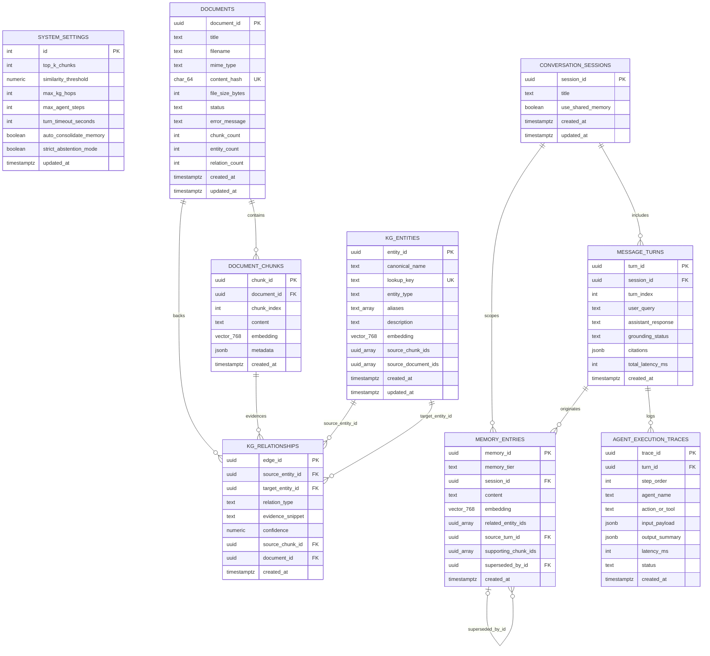

# Database Architecture & Data Model Specification (DATABASE.md)
**Product:** Agentic RAG System with Centralized Memory and Knowledge Graph  
**Version:** 1.0.0  
**Status:** Approved Baseline — Source of Truth for Data Engineering  
**References:** Paired with `PRD.md` (v1.0.0), `DESIGN.md` (v1.0.0), and `ARCHITECTURE.md` (v1.0.0)

---

## 1. Database Technology & Extensions

### 1.1 Core Engine
- **Database Engine:** **Supabase PostgreSQL (PostgreSQL 15+ / 16+)** (`[APPROVED D-02]`)
- **Deployment Mode:** Single unified transactional database storing relational metadata, vector embeddings, Knowledge Graph nodes and directed edges, Centralized Memory records, and agent execution traces.
- **Why Unified PostgreSQL:** Eliminates dual-write consistency bugs between separate vector, graph, and relational databases. Deleting a document or updating a memory entry executes within a single ACID transaction.

### 1.2 Required PostgreSQL Extensions
| Extension | Schema | Purpose |
| :--- | :--- | :--- |
| `pgcrypto` | `extensions` / `public` | Generates cryptographically strong UUIDv4 primary keys (`gen_random_uuid()`). |
| `vector` (`pgvector` 0.7+) | `extensions` / `public` | Provides the `vector(768)` data type, cosine distance operator (`<=>`), and HNSW indexing for embeddings produced by `text-embedding-004`. |
| `pg_trgm` | `extensions` / `public` | Supports fast case-insensitive substring and fuzzy matching on `kg_entities.canonical_name` and `documents.title` during Explorer searches. |

---

## 2. Entity-Relationship Diagram & Relationships

### 2.1 Mermaid ER Diagram

### 2.2 Cardinality & Referential Integrity Summary
- **`documents` → `document_chunks` (1:N):** Each document is split into ordered chunks. Deleting a document cascades (`ON DELETE CASCADE`) to remove all its chunks.
- **`document_chunks` & `documents` → `kg_relationships` (1:N):** Every directed Knowledge Graph relationship edge is anchored to the exact `source_chunk_id` and `document_id` from which it was extracted (`FR-15`). Deleting a document or chunk cascades (`ON DELETE CASCADE`) to delete those specific edges (`FR-16`).
- **`kg_entities` → `kg_relationships` (1:N as Source and Target):** Canonical entities can appear across multiple documents. `kg_entities` tracks supporting `source_chunk_ids` and `source_document_ids` arrays; when a document is deleted, its IDs are pruned from those arrays, and any entity whose `source_chunk_ids` array becomes empty is deleted in the same transaction.
- **`conversation_sessions` → `message_turns` (1:N):** Deleting a session cascades (`ON DELETE CASCADE`) to its turns and execution traces.
- **`message_turns` → `agent_execution_traces` (1:N):** Every turn records an ordered sequence of agent execution steps (`ON DELETE CASCADE`).
- **`message_turns` & `conversation_sessions` → `memory_entries` (1:N):**
  - `SESSION` tier memories belong to a specific `session_id` (`ON DELETE CASCADE`).
  - `LONG_TERM_SEMANTIC` and `LONG_TERM_EPISODIC` memories are workspace-shared (`session_id` is nullable or retained for audit, and `source_turn_id` uses `ON DELETE SET NULL` so shared workspace knowledge survives even if an old chat thread is cleaned up).

---

## 3. Tables, Columns, Keys, and Constraints

> **Note on Working Memory (`FR-07`):** Tier 1 (`WORKING` turn scratchpad) lives in-memory inside the Google ADK `TurnWorkingState` during the active request (`<= 30s`) and is snapshotted into `agent_execution_traces` upon turn completion. Only persistent tiers (`SESSION`, `LONG_TERM_SEMANTIC`, `LONG_TERM_EPISODIC`) are stored in `memory_entries` to avoid unnecessary database churn.

### 3.1 Table: `system_settings`
Singleton table holding runtime retrieval and agent configuration (`Screen 4`, `FR-01`).

| Column Name | Data Type | Nullable | Default | Constraints & Validation |
| :--- | :--- | :---: | :--- | :--- |
| `id` | `INTEGER` | No | `1` | `PRIMARY KEY`, `CHECK (id = 1)` (enforces singleton row) |
| `top_k_chunks` | `INTEGER` | No | `5` | `CHECK (top_k_chunks BETWEEN 1 AND 20)` |
| `similarity_threshold` | `NUMERIC(3,2)` | No | `0.65` | `CHECK (similarity_threshold BETWEEN 0.00 AND 1.00)` |
| `max_kg_hops` | `INTEGER` | No | `2` | `CHECK (max_kg_hops BETWEEN 1 AND 2)` (`A-05`) |
| `max_agent_steps` | `INTEGER` | No | `5` | `CHECK (max_agent_steps BETWEEN 3 AND 8)` (`NFR-03`) |
| `turn_timeout_seconds` | `INTEGER` | No | `30` | `CHECK (turn_timeout_seconds BETWEEN 10 AND 60)` |
| `auto_consolidate_memory` | `BOOLEAN` | No | `true` | Enables automatic post-verification memory writes (`D-04`) |
| `strict_abstention_mode` | `BOOLEAN` | No | `true` | Enforces `INSUFFICIENT_EVIDENCE` when below threshold |
| `updated_at` | `TIMESTAMPTZ` | No | `now()` | Auto-updated on mutation |

### 3.2 Table: `documents`
Tracks uploaded source documents and ingestion pipeline progress (`PRD.md 7.1`).

| Column Name | Data Type | Nullable | Default | Constraints & Validation |
| :--- | :--- | :---: | :--- | :--- |
| `document_id` | `UUID` | No | `gen_random_uuid()` | `PRIMARY KEY` |
| `title` | `TEXT` | No | — | `CHECK (char_length(trim(title)) > 0)` |
| `filename` | `TEXT` | No | — | Original filename with extension |
| `mime_type` | `TEXT` | No | — | `CHECK (mime_type IN ('application/pdf', 'text/markdown', 'text/plain'))` |
| `content_hash` | `CHAR(64)` | No | — | `UNIQUE` (SHA-256 hex digest for idempotent ingestion `NFR-06`) |
| `file_size_bytes` | `INTEGER` | No | — | `CHECK (file_size_bytes > 0 AND file_size_bytes <= 26214400)` (`<= 25 MB`) |
| `status` | `TEXT` | No | `'QUEUED'` | `CHECK (status IN ('QUEUED', 'CHUNKING', 'EXTRACTING_KG', 'INDEXED', 'FAILED'))` |
| `error_message` | `TEXT` | Yes | `NULL` | Populated only when `status = 'FAILED'` |
| `chunk_count` | `INTEGER` | No | `0` | `CHECK (chunk_count >= 0)` |
| `entity_count` | `INTEGER` | No | `0` | `CHECK (entity_count >= 0)` |
| `relation_count` | `INTEGER` | No | `0` | `CHECK (relation_count >= 0)` |
| `created_at` | `TIMESTAMPTZ` | No | `now()` | — |
| `updated_at` | `TIMESTAMPTZ` | No | `now()` | — |

### 3.3 Table: `document_chunks`
Stores deterministic text chunks, metadata offsets, and `pgvector` embeddings (`PRD.md 7.2`).

| Column Name | Data Type | Nullable | Default | Constraints & Validation |
| :--- | :--- | :---: | :--- | :--- |
| `chunk_id` | `UUID` | No | `gen_random_uuid()` | `PRIMARY KEY` |
| `document_id` | `UUID` | No | — | `FOREIGN KEY REFERENCES documents(document_id) ON DELETE CASCADE` |
| `chunk_index` | `INTEGER` | No | — | `CHECK (chunk_index >= 0)`, `UNIQUE (document_id, chunk_index)` |
| `content` | `TEXT` | No | — | `CHECK (char_length(trim(content)) > 0)` |
| `embedding` | `vector(768)` | No | — | 768-dim vector (`text-embedding-004`) |
| `metadata` | `JSONB` | No | `'{}'::jsonb` | Required keys: `page_number` (int/null), `section_heading` (text/null), `char_start` (int), `char_end` (int) |
| `created_at` | `TIMESTAMPTZ` | No | `now()` | — |

### 3.4 Table: `kg_entities`
Stores canonical Knowledge Graph nodes resolved across documents (`PRD.md 7.3`, `D-03`).

| Column Name | Data Type | Nullable | Default | Constraints & Validation |
| :--- | :--- | :---: | :--- | :--- |
| `entity_id` | `UUID` | No | `gen_random_uuid()` | `PRIMARY KEY` |
| `canonical_name` | `TEXT` | No | — | Display name (e.g., `'PaymentGateway'`) |
| `lookup_key` | `TEXT` | No | — | `UNIQUE`, normalized lowercase alphanumeric key for deterministic deduplication (`FR-14`) |
| `entity_type` | `TEXT` | No | — | `CHECK (entity_type IN ('System', 'Component', 'Organization', 'Person', 'Concept', 'Process', 'Policy', 'Location', 'Event'))` (`D-03`) |
| `aliases` | `TEXT[]` | No | `'{}'` | Alternative surface forms encountered in chunks |
| `description` | `TEXT` | No | `''` | Synthesized entity description |
| `embedding` | `vector(768)` | No | — | Embedding of `canonical_name + description` for semantic entity linking |
| `source_chunk_ids` | `UUID[]` | No | `'{}'` | `CHECK (cardinality(source_chunk_ids) > 0)` (`FR-15`) |
| `source_document_ids`| `UUID[]` | No | `'{}'` | `CHECK (cardinality(source_document_ids) > 0)` |
| `created_at` | `TIMESTAMPTZ` | No | `now()` | — |
| `updated_at` | `TIMESTAMPTZ` | No | `now()` | — |

### 3.5 Table: `kg_relationships`
Stores directed Knowledge Graph edges with mandatory chunk provenance (`PRD.md 7.4`, `D-03`).

| Column Name | Data Type | Nullable | Default | Constraints & Validation |
| :--- | :--- | :---: | :--- | :--- |
| `edge_id` | `UUID` | No | `gen_random_uuid()` | `PRIMARY KEY` |
| `source_entity_id` | `UUID` | No | — | `FOREIGN KEY REFERENCES kg_entities(entity_id) ON DELETE CASCADE` |
| `target_entity_id` | `UUID` | No | — | `FOREIGN KEY REFERENCES kg_entities(entity_id) ON DELETE CASCADE` |
| `relation_type` | `TEXT` | No | — | `CHECK (relation_type IN ('DEPENDS_ON', 'PART_OF', 'MANAGED_BY', 'AUTHORED_BY', 'CAUSES', 'MITIGATES', 'COMMUNICATES_WITH', 'GOVERNED_BY', 'LOCATED_IN', 'RELATED_TO'))` (`D-03`) |
| `evidence_snippet` | `TEXT` | No | — | `CHECK (char_length(evidence_snippet) BETWEEN 1 AND 500)` |
| `confidence` | `NUMERIC(3,2)` | No | `0.85` | `CHECK (confidence BETWEEN 0.00 AND 1.00)` |
| `source_chunk_id` | `UUID` | No | — | `FOREIGN KEY REFERENCES document_chunks(chunk_id) ON DELETE CASCADE` |
| `document_id` | `UUID` | No | — | `FOREIGN KEY REFERENCES documents(document_id) ON DELETE CASCADE` |
| `created_at` | `TIMESTAMPTZ` | No | `now()` | `UNIQUE (source_entity_id, target_entity_id, relation_type, source_chunk_id)` |

### 3.6 Table: `conversation_sessions`
Tracks user research threads and active memory scope (`PRD.md 7.5`).

| Column Name | Data Type | Nullable | Default | Constraints & Validation |
| :--- | :--- | :---: | :--- | :--- |
| `session_id` | `UUID` | No | `gen_random_uuid()` | `PRIMARY KEY` |
| `title` | `TEXT` | No | `'New Research Session'` | `CHECK (char_length(trim(title)) > 0)` |
| `use_shared_memory` | `BOOLEAN` | No | `true` | Controls whether `LONG_TERM_*` memories are queried/written |
| `created_at` | `TIMESTAMPTZ` | No | `now()` | — |
| `updated_at` | `TIMESTAMPTZ` | No | `now()` | Updated on every new turn |

### 3.7 Table: `message_turns`
Stores individual query/response turns and their structured provenance map (`PRD.md 7.5`).

| Column Name | Data Type | Nullable | Default | Constraints & Validation |
| :--- | :--- | :---: | :--- | :--- |
| `turn_id` | `UUID` | No | `gen_random_uuid()` | `PRIMARY KEY` |
| `session_id` | `UUID` | No | — | `FOREIGN KEY REFERENCES conversation_sessions(session_id) ON DELETE CASCADE` |
| `turn_index` | `INTEGER` | No | — | `CHECK (turn_index >= 0)`, `UNIQUE (session_id, turn_index)` |
| `user_query` | `TEXT` | No | — | `CHECK (char_length(trim(user_query)) > 0)` |
| `assistant_response`| `TEXT` | No | — | Synthesized markdown with inline citation badges |
| `grounding_status` | `TEXT` | No | — | `CHECK (grounding_status IN ('GROUNDED', 'PARTIAL', 'INSUFFICIENT_EVIDENCE'))` |
| `citations` | `JSONB` | No | `'{"chunks": [], "kg_paths": [], "memories": []}'::jsonb` | Structured provenance map linking inline badges to `chunk_id`, `edge_id`, and `memory_id` |
| `total_latency_ms` | `INTEGER` | No | `0` | `CHECK (total_latency_ms >= 0)` |
| `created_at` | `TIMESTAMPTZ` | No | `now()` | — |

### 3.8 Table: `memory_entries`
Stores Centralized Session and Long-Term Shared Memories with provenance and superseding links (`PRD.md 7.6`, `FR-07`–`FR-11`).

| Column Name | Data Type | Nullable | Default | Constraints & Validation |
| :--- | :--- | :---: | :--- | :--- |
| `memory_id` | `UUID` | No | `gen_random_uuid()` | `PRIMARY KEY` |
| `memory_tier` | `TEXT` | No | — | `CHECK (memory_tier IN ('SESSION', 'LONG_TERM_SEMANTIC', 'LONG_TERM_EPISODIC'))` |
| `session_id` | `UUID` | Yes | `NULL` | `FOREIGN KEY REFERENCES conversation_sessions(session_id) ON DELETE CASCADE` (Required when `memory_tier = 'SESSION'`) |
| `content` | `TEXT` | No | — | Distilled atomic fact or episodic summary (`CHECK (char_length(trim(content)) > 0)`) |
| `embedding` | `vector(768)` | No | — | 768-dim vector for semantic memory recall (`FR-08`) |
| `related_entity_ids`| `UUID[]` | No | `'{}'` | References canonical `kg_entities.entity_id`s |
| `source_turn_id` | `UUID` | Yes | `NULL` | `FOREIGN KEY REFERENCES message_turns(turn_id) ON DELETE SET NULL` (`FR-10`) |
| `supporting_chunk_ids`| `UUID[]` | No | `'{}'` | Source `document_chunks.chunk_id`s that verified the fact |
| `superseded_by_id` | `UUID` | Yes | `NULL` | `FOREIGN KEY REFERENCES memory_entries(memory_id) ON DELETE SET NULL` (`FR-09`, `CHECK (superseded_by_id != memory_id)`) |
| `created_at` | `TIMESTAMPTZ` | No | `now()` | — |

### 3.9 Table: `agent_execution_traces`
Stores immutable step-by-step telemetry for every agent invocation in a turn (`PRD.md 7.7`, `FR-20`).

| Column Name | Data Type | Nullable | Default | Constraints & Validation |
| :--- | :--- | :---: | :--- | :--- |
| `trace_id` | `UUID` | No | `gen_random_uuid()` | `PRIMARY KEY` |
| `turn_id` | `UUID` | No | — | `FOREIGN KEY REFERENCES message_turns(turn_id) ON DELETE CASCADE` |
| `step_order` | `INTEGER` | No | — | `CHECK (step_order >= 1)`, `UNIQUE (turn_id, step_order)` |
| `agent_name` | `TEXT` | No | — | `CHECK (agent_name IN ('Orchestrator', 'MemoryAgent', 'VectorRetriever', 'KGRetriever', 'SynthesisVerifier'))` |
| `action_or_tool` | `TEXT` | No | — | Name of tool or reasoning step executed |
| `input_payload` | `JSONB` | No | `'{}'::jsonb` | Sub-queries, seed entities, or parameters |
| `output_summary` | `JSONB` | No | `'{}'::jsonb` | Retrieved chunk/edge/memory IDs and similarity scores |
| `latency_ms` | `INTEGER` | No | `0` | `CHECK (latency_ms >= 0)` |
| `status` | `TEXT` | No | `'SUCCESS'` | `CHECK (status IN ('SUCCESS', 'FALLBACK', 'ERROR'))` |
| `created_at` | `TIMESTAMPTZ` | No | `now()` | — |

---

## 4. Indexes Based on Real Application Queries

Every index below is justified by a specific, high-frequency query path in `ARCHITECTURE.md`:

| Index Name | Table & Column(s) | Index Type | Target Query Pattern Supported |
| :--- | :--- | :--- | :--- |
| `idx_chunks_embedding_hnsw` | `document_chunks (embedding vector_cosine_ops)` | `HNSW` (`m=16, ef_construction=64`) | `VectorRetrievalAgent` top-K semantic chunk search (`ORDER BY embedding <=> $1 LIMIT $2`). |
| `idx_entities_embedding_hnsw` | `kg_entities (embedding vector_cosine_ops)` | `HNSW` (`m=16, ef_construction=64`) | `KnowledgeGraphAgent` fuzzy seed entity resolution when exact/alias match fails. |
| `idx_memories_embedding_hnsw` | `memory_entries (embedding vector_cosine_ops) WHERE superseded_by_id IS NULL` | Partial `HNSW` | `MemoryAgent` pre-synthesis recall of active (non-superseded) memories (`FR-08`, `FR-09`). |
| `idx_chunks_doc_order` | `document_chunks (document_id, chunk_index)` | `B-Tree` (Unique) | Slide-Over Chunk Inspector (`GET /api/v1/documents/{doc_id}/chunks`) and cascading delete lookup. |
| `idx_entities_lookup_key` | `kg_entities (lookup_key)` | `B-Tree` (Unique) | Fast O(1) entity canonicalization during ingestion (`FR-14`). |
| `idx_entities_aliases_gin` | `kg_entities USING GIN (aliases)` | `GIN` | Matching surface entity mentions against known aliases (`$1 = ANY(aliases)`). |
| `idx_entities_source_docs_gin`| `kg_entities USING GIN (source_document_ids)` | `GIN` | Identifying affected entities when a document is deleted (`FR-16`). |
| `idx_rel_source_entity` | `kg_relationships (source_entity_id, relation_type)` | `B-Tree` | Outgoing 1–2 hop recursive CTE traversal from seed entities (`FR-03`). |
| `idx_rel_target_entity` | `kg_relationships (target_entity_id, relation_type)` | `B-Tree` | Incoming 1–2 hop recursive CTE traversal to seed entities (`FR-03`). |
| `idx_rel_source_chunk` | `kg_relationships (source_chunk_id)` | `B-Tree` | Looking up all KG triples extracted from a selected chunk in the Provenance Drawer (`FR-19`). |
| `idx_memories_active_tier` | `memory_entries (memory_tier, session_id, created_at DESC) WHERE superseded_by_id IS NULL` | Partial `B-Tree` | Filtering active Session vs. Long-Term memories in the Memory Explorer (`Screen 3`). |
| `idx_turns_session_order` | `message_turns (session_id, turn_index ASC)` | `B-Tree` (Unique) | Loading conversation history in chronological order (`Screen 1`). |
| `idx_traces_turn_step` | `agent_execution_traces (turn_id, step_order ASC)` | `B-Tree` (Unique) | Rendering the Agent Execution Trace Timeline (`Screen 1 Tab 3`). |

---

## 5. Ownership, Authorization & Row-Level Security (RLS)

### 5.1 Data Ownership & Access Model
- **Single-Workspace Shared Knowledge Corpus (`[ASSUMPTION A-04]`):** All `documents`, `document_chunks`, `kg_entities`, and `kg_relationships` belong to the shared workspace.
- **Role Enforcement (`[APPROVED D-05]`):**
  - **`Researcher` Role:** Full read access to documents, chunks, KG, traces, and settings; full read/write access to `conversation_sessions` and `message_turns`; delete access restricted strictly to `memory_entries` where `memory_tier = 'SESSION'`.
  - **`Knowledge Admin` Role:** Full privileges across all tables, including document upload/re-index/delete, global `LONG_TERM_*` memory deletion, and `system_settings` mutation.
  - **`MemoryAgent` Write Guard (`[APPROVED D-04]`):** Application service layer enforces that `LONG_TERM_SEMANTIC` and `LONG_TERM_EPISODIC` inserts occur only after `SynthesisVerifierAgent` confirms `grounding_status = 'GROUNDED'`.

### 5.2 Supabase Row-Level Security (RLS) Policy Specification
Because Supabase exposes a public PostgREST API by default, **Row-Level Security (`ALTER TABLE ... ENABLE ROW LEVEL SECURITY`) is enabled on all 9 tables in the `public` schema**:
1. **Block Direct Anonymous/Client PostgREST Access:** No permissive policies are granted to the Supabase `anon` role. The browser client never queries Supabase directly (`ARCHITECTURE.md Section 12.1`).
2. **Backend Connection Access:** The FastAPI backend connects via the privileged database role (`postgres` / `service_role`) over an encrypted server-side pool and enforces role boundaries (`X-App-Role` + `X-Admin-Api-Key`) at the API dependency layer.
3. **Future Multi-Tenant Readiness:** Enabling RLS on all tables from Day 1 ensures that if the product later transitions to multi-tenant Supabase Auth JWTs (`Section 13.2` of `ARCHITECTURE.md`), tenant-scoped RLS policies (`workspace_id = auth.jwt() ->> 'workspace_id'`) can be attached without schema restructuring.

---

## 6. Sensitive-Data Handling

1. **Zero Credential Persistence:** API keys (`GOOGLE_API_KEY`, `ADMIN_API_KEY`) and connection secrets are never stored in `system_settings` or logged inside `agent_execution_traces`.
2. **Trace Payload Sanitization:** `agent_execution_traces.input_payload` and `output_summary` log only chunk UUIDs, entity UUIDs, similarity scores, and sub-query strings—avoiding full duplicate copies of large document texts in trace tables.
3. **Deterministic Content Hashing:** Uploaded files are fingerprinted using `SHA-256` (`documents.content_hash`). Raw binary file blobs are not retained in the database once text chunks and offsets are extracted, minimizing storage footprint and data exposure.
4. **Encryption:** All database connections require TLS (`sslmode=require`), and volume storage is encrypted at rest via Supabase AES-256 disk encryption.

---

## 7. Migration and Seed Strategy

### 7.1 Migration Strategy
- **Location:** Versioned, sequential SQL migration files stored in `supabase/migrations/` (starting with `0001_initial_schema.sql`).
- **Execution Order inside `0001_initial_schema.sql`:**
  1. Enable extensions (`pgcrypto`, `vector`, `pg_trgm`).
  2. Create tables in dependency order (`system_settings` → `documents` → `document_chunks` → `kg_entities` → `kg_relationships` → `conversation_sessions` → `message_turns` → `memory_entries` → `agent_execution_traces`).
  3. Create B-Tree, GIN, and HNSW indexes.
  4. Create the `traverse_kg_subgraph(seed_entity_ids UUID[], max_hops INT)` SQL function for bounded 1–2 hop graph traversal with cycle prevention.
  5. Enable Row-Level Security (`ENABLE ROW LEVEL SECURITY`) on all 9 tables.
  6. Attach an `update_updated_at_column()` trigger to `system_settings`, `documents`, `kg_entities`, and `conversation_sessions`.

### 7.2 Seed Strategy (`supabase/seed.sql`)
- **Mandatory Singleton Seed:** Inserts the default configuration row into `system_settings` (`id = 1`, `top_k_chunks = 5`, `similarity_threshold = 0.65`, `max_kg_hops = 2`, `max_agent_steps = 5`, `turn_timeout_seconds = 30`, `auto_consolidate_memory = true`, `strict_abstention_mode = true`) using `ON CONFLICT (id) DO NOTHING`.
- **Optional Verification Corpus Seed:** Provides a clean script to ingest 2 lightweight sample architecture markdown documents so developers can immediately test 2-hop Knowledge Graph traversal and Centralized Memory recall upon first boot.

---

## 8. Backup, Recovery & Re-Indexability Considerations

1. **Automated Database Backups:** Relies on Supabase daily automated backups and Point-in-Time Recovery (PITR) for `conversation_sessions`, `message_turns`, and curated `memory_entries`.
2. **Deterministic Re-Indexability of Derived Data:**
   - Vector embeddings (`document_chunks.embedding`, `kg_entities.embedding`, `memory_entries.embedding`) and Knowledge Graph extractions are deterministically regenerable via the `POST /api/v1/documents/{doc_id}/reindex` workflow if the embedding model or extraction schema is upgraded in the future.
3. **Transactional Cleanup on Failed Ingestion:** If an ingestion job fails mid-flight during `EXTRACTING_KG`, the pipeline deletes any partial chunks/edges for that `document_id` within a single rollback transaction and marks `documents.status = 'FAILED'`, guaranteeing zero orphaned vectors or dangling graph edges.

