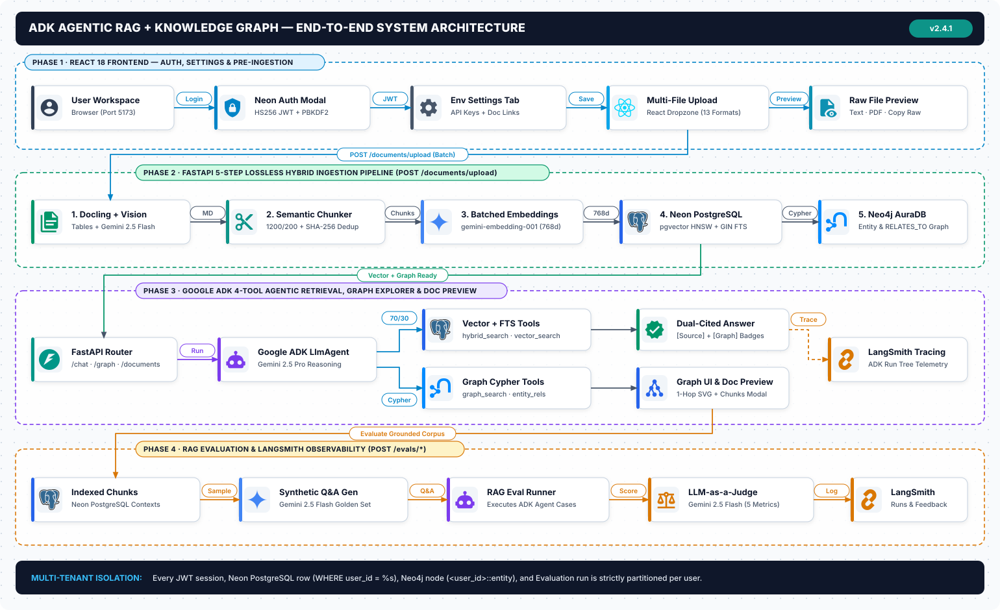

# :material-sitemap: System Architecture

The **ADK Agentic RAG + Knowledge Graph** platform is engineered as a modular, multi-tenant **Hybrid Document Intelligence** system combining **Google Agent Development Kit (`google-adk`)**, **Gemini 2.5**, **Neon Console Serverless PostgreSQL (`pgvector` + Full-Text Search)**, and **Neo4j**.

---

## :material-layers-outline: Architectural Pillars

<div class="grid cards" markdown>

-   :material-shield-lock-outline:{ .lg .middle } **Neon PostgreSQL Authentication**

    ---

    Stateless `HS256` JWT Bearer authentication backed by a `users` table in Neon PostgreSQL with `PBKDF2-HMAC-SHA256` (`260,000` iterations) password hashing.

-   :material-pipe:{ .lg .middle } **5-Step Dual Ingestion Engine**

    ---

    Asynchronous worker pipeline with SHA-256 content-hash deduplication & atomic version replacement that parses 13 document formats, chunks text semantically, embeds in batches (`768`-dim), indexes in Neon Postgres, and extracts entities into Neo4j.

-   :material-brain:{ .lg .middle } **Google ADK Multi-Tool Agent**

    ---

    `LlmAgent` (`gemini-2.5-pro`) equipped with 4 specialized retrieval tools (`hybrid_search`, `vector_search`, `graph_search`, `get_entity_relationships`) and dynamic user context injection.

-   :material-graph-outline:{ .lg .middle } **Interactive Bioluminescent UI**

    ---

    React 18 + Vite single-page workspace featuring client-side raw file & indexed chunk previews, real-time per-step ingestion telemetry, tool execution badges, dual citations, an interactive SVG Neo4j topology explorer, and a Gemini 2.5 Flash + LangSmith evaluation console.

</div>

---

## 1. End-to-End System Architecture (`v2.4.1`)



---

## 2. Backend Module Architecture (`app/`)

| Module | File | Responsibility |
|--------|------|----------------|
| **Configuration** | `app/config.py` | Loads `.env`, validates `GOOGLE_API_KEY`, configures `DATABASE_URL`, `NEO4J_*`, `JWT_*`, `AGENT_MODEL`, and `GRAPH_EXTRACTION_MODEL`. |
| **Database Layer** | `app/database.py` | Manages the Neon PostgreSQL `ThreadedConnectionPool` (with TCP keepalives, connection health checks, and URL normalization) and the Neo4j driver (`GraphDatabase.driver`). Automatically initializes `pgvector`, tables, HNSW/GIN indexes, and Neo4j constraints on startup. |
| **Authentication** | `app/auth.py` | Implements `PBKDF2-HMAC-SHA256` password hashing (`260,000` iterations), `HS256` JWT signing/verification, user registration/login against the Neon `users` table, and the `get_current_user` FastAPI security dependency. |
| **Format Parsers** | `app/parsers.py` | Dispatches uploaded files by extension (`.pdf`, `.docx`, `.xlsx`, `.xls`, `.pptx`, `.txt`, `.md`, `.csv`, `.json`, `.xml`, `.html`, `.log`) to specialized text extractors. |
| **Semantic Chunker** | `app/chunking.py` | Splits extracted document text along markdown headers, paragraphs, and sentences (`chunk_size=1200`, `overlap=200`) to preserve semantic coherence. |
| **Embeddings** | `app/embeddings.py` | Wraps `google-genai` `gemini-embedding-001` (`768` dimensions) with batching (`50` chunks per call) for high-throughput document ingestion and single-query embedding. |
| **Vector & Hybrid Store** | `app/rag_store.py` | Executes Neon PostgreSQL CRUD (`add_document_chunks`, `get_document_preview`, `delete_document_chunks`, `list_user_documents`) and retrieval (`search_documents` pure vector cosine search and `hybrid_search_documents` combining `70%` vector similarity + `30%` `ts_rank_cd` full-text score). |
| **Knowledge Graph Store** | `app/graph_store.py` | Extracts structured `ExtractedEntity` and `ExtractedRelationship` objects from chunks using `gemini-2.5-flash` and persists/queries them in Neo4j via parameterized Cypher queries. |
| **Dual Ingestion Pipeline** | `app/ingest.py` | Orchestrates the 5-step ingestion pipeline and maintains real-time per-user step telemetry (`_user_ingestion_progress`) polled by the frontend UI. |
| **Google ADK Agent** | `app/agent.py` | Defines `root_agent` (`LlmAgent`) equipped with 4 tools (`hybrid_search`, `vector_search`, `graph_search`, `get_entity_relationships`) and dynamic system instructions injecting the active `user_id`. |
| **RAG Evaluation & LangSmith** | `app/evals/` | Generates synthetic Q&A golden datasets from indexed chunks (`dataset_generator.py`), evaluates RAG outputs across 5 metrics using `gemini-2.5-flash` LLM-as-a-Judge (`judge.py`), orchestrates local/LangSmith runs (`runner.py`), and logs traces/feedback (`langsmith_tracer.py`). |
| **REST API** | `app/api.py` | Exposes FastAPI endpoints for Auth, Settings, Upload, Live Ingestion Progress, Documents & Preview, Knowledge Graph, Agentic Chat, and RAG Evaluation. Runs heavy ingestion in `asyncio.to_thread` using OS temp storage (`/tmp/adk_rag_uploads`) so Uvicorn `--reload` is never interrupted. |

---

## 3. End-to-End Sequence Flows

=== ":material-shield-key: 1. Authentication Flow"

    ```mermaid
    sequenceDiagram
        actor User
        participant UI as React Frontend
        participant API as FastAPI (/auth/*)
        participant Auth as app/auth.py
        participant Neon as Neon PostgreSQL (users)

        User->>UI: Enter Email & Password (Sign In or Sign Up)
        UI->>API: POST /auth/signup or POST /auth/login
        API->>Auth: register_user() / authenticate_user()
        Auth->>Neon: SELECT / INSERT user record
        Neon-->>Auth: User row (user_id, email, name, password_hash)
        Auth->>Auth: Verify PBKDF2-SHA256 hash & sign HS256 JWT
        Auth-->>API: {token, user}
        API-->>UI: 200 OK {token, user}
        UI->>UI: Save JWT in localStorage & attach Authorization: Bearer <token>
    ```

=== ":material-pipe: 2. 5-Step Dual Ingestion Flow"

    ```mermaid
    sequenceDiagram
        actor User
        participant UI as React UI (UploadTab / IngestionTab)
        participant API as FastAPI (app/api.py)
        participant Ingest as app/ingest.py
        participant Gemini as Google Gemini API
        participant Neon as Neon PostgreSQL (pgvector)
        participant Neo4j as Neo4j Knowledge Graph

        User->>UI: Select file & click "Ingest into Neon Postgres & Neo4j"
        UI->>UI: Switch to Ingestion Pipeline tab & poll /ingest/progress
        UI->>API: POST /documents/upload (multipart file + Bearer JWT)
        API->>Ingest: asyncio.to_thread(ingest_document)

        Note over Ingest: Step 1 — Text Extraction
        Ingest->>Ingest: parse_file(file_path) -> raw text

        Note over Ingest: Step 2 — Semantic Chunking
        Ingest->>Ingest: chunk_text(text, size=1200, overlap=200)

        Note over Ingest: Step 3 — Batched Embeddings
        Ingest->>Gemini: get_embeddings_batch(chunks) [gemini-embedding-001]
        Gemini-->>Ingest: 768-dim float vectors

        Note over Ingest: Step 4 — Neon PostgreSQL Indexing
        Ingest->>Neon: INSERT documents + execute_values(document_chunks)

        Note over Ingest: Step 5 — Neo4j Graph Extraction
        Ingest->>Gemini: extract_graph_from_chunks() [gemini-2.5-flash JSON]
        Gemini-->>Ingest: Entities & Relationships
        Ingest->>Neo4j: Cypher MERGE (:Entity), (:Document), [:RELATES_TO]
        Ingest->>Neon: UPDATE documents SET entities_count, relationships_count

        Ingest-->>API: Summary dict (chunks, entities, relationships)
        API-->>UI: 200 OK Ingestion Complete
    ```

=== ":material-robot: 3. Multi-Tool Agentic Retrieval Flow"

    ```mermaid
    sequenceDiagram
        actor User
        participant UI as React ChatTab
        participant API as FastAPI (POST /chat)
        participant Runner as Google ADK Runner (LlmAgent)
        participant Rag as app/rag_store.py (Neon Postgres)
        participant Graph as app/graph_store.py (Neo4j)

        User->>UI: Ask question
        UI->>API: POST /chat {question, session_id} + Bearer JWT
        API->>Runner: runner.run_async(user_id, session_id, message)

        alt Hybrid / Vector Query
            Runner->>Rag: hybrid_search(query, user_id) or vector_search(query, user_id)
            Rag-->>Runner: Top-K ranked document chunks + similarity scores
        end

        alt Entity / Relationship Query
            Runner->>Graph: graph_search(query, user_id) or get_entity_relationships(entity_name, user_id)
            Graph-->>Runner: Matched Neo4j entities & (Source)-[RELATES_TO]->(Target) facts
        end

        Runner-->>API: Final synthesized response + tool call events
        API-->>UI: {answer, tools_used, session_id}
        UI-->>User: Render Markdown answer with Tool Badges & [Source]/[Graph] citations
    ```

=== ":material-delete-sweep: 4. Cascade Deletion Flow"

    ```mermaid
    flowchart LR
        A["DELETE /documents/{document_id}"] --> B["Neon PostgreSQL: Delete from documents & document_chunks"]
        B --> C["Neo4j Step 1: Delete RELATES_TO edges for document_id"]
        C --> D["Neo4j Step 2: DETACH DELETE (:Document) node"]
        D --> E["Neo4j Step 3: Prune orphaned (:Entity) nodes"]
    ```

---

## 4. Multi-Tenant Security & Data Isolation

!!! tip "Defense-in-Depth Tenant Partitioning"
    Every data record across the entire stack is partitioned by the authenticated `user_id` extracted from the verified `HS256` JWT token:

    1. **Authentication Layer (`app/auth.py`)**: Extracts and verifies the `user_id` (`sub` claim) on every protected API request.
    2. **Neon PostgreSQL (`app/rag_store.py`)**: Every `SELECT` and `DELETE` query enforces `WHERE user_id = %s`.
    3. **Neo4j Knowledge Graph (`app/graph_store.py`)**: Every node ID is prefixed with `<user_id>::` (e.g., `user_123::postgresql`) and every Cypher `MATCH` filters on `{user_id: $user_id}`.
    4. **Google ADK Session Context (`app/agent.py`)**: ADK chat sessions are keyed by `(app_name, user_id, session_id)` and `build_agent_instruction(ReadonlyContext)` injects the active `user_id` directly into the agent's system prompt.
