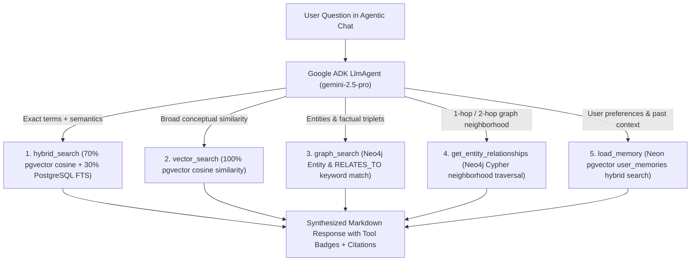

# Agentic Chat & Graph Tools

The chat subsystem uses **Google Agent Development Kit (`google-adk`)** and **Gemini (`gemini-2.5-pro`)** to reason across both **Neon PostgreSQL (`pgvector` + Full-Text Search)** and the **Neo4j Knowledge Graph**.

---

## Multi-Tool Agent Architecture (`app/agent.py`)

The root agent (`root_agent`) is an instance of `google.adk.agents.LlmAgent` configured with five specialized tools and backed by **`NeonSessionService`** + **`NeonMemoryService`**:



---

## The 5 Agent Tools in Detail

### 1. `hybrid_search(query, user_id, top_k=5)`
- **Backend Function**: `app/rag_store.py -> hybrid_search_documents()`
- **How It Works**: Embeds `query` with `gemini-embedding-001` (`768`-dim) and runs a single SQL query on Neon PostgreSQL combining cosine similarity (`0.7` weight) and English full-text rank `ts_rank_cd` (`0.3` weight).
- **Best For**: Technical questions, specific names, numbers, dates, and general factual questions over uploaded documents.

### 2. `vector_search(query, user_id, top_k=5)`
- **Backend Function**: `app/rag_store.py -> search_documents()`
- **How It Works**: Queries `document_chunks` ordered purely by `pgvector` cosine distance (`embedding <=> query_vec`).
- **Best For**: Conceptual, thematic, or paraphrased queries where exact keywords may not appear in the source text.

### 3. `graph_search(query, tool_context)`
- **Backend Function**: `app/graph_store.py -> search_knowledge_graph()`
- **How It Works**: Tokenizes the query and searches Neo4j `(:Entity)` names, dynamically inferred domain categories (`entity_type`), descriptions, and `[:RELATES_TO]` facts scoped to `user_id`.
- **Best For**: Discovering how any domain entities, subjects, attributes, items, processes, or categories connect, relate, depend on each other, or compare across one or more documents.

### 4. `get_entity_relationships(entity_name, tool_context)`
- **Backend Function**: `app/graph_store.py -> get_entity_relationships_from_graph()`
- **How It Works**: Finds the matching `(:Entity)` node in Neo4j (regardless of category) and traverses all incoming and outgoing `[:RELATES_TO]` edges.
- **Best For**: Deep-diving into a specific named entity's direct neighborhood, dependencies, and supporting facts.

### 5. `load_memory(query, tool_context)` (`v2.5.0`)
- **Backend Service**: `app/memory_store.py -> NeonMemoryService.search_memory()`
- **How It Works**: Embeds `query` with `gemini-embedding-001` (`768`-dim) and runs hybrid vector + full-text search over the authenticated user's `user_memories` table in Neon PostgreSQL (`fact`, `preference`, and `summary` entries distilled automatically by `gemini-2.5-flash` or added manually).
- **Best For**: Recalling user formatting preferences, ongoing project context, and cross-session continuity.

---

## Persistent Sessions & Long-Term Memory (`v2.5.0`)

- **Short-Term Session Persistence (`NeonSessionService`)**: Replaces `InMemorySessionService` with Neon PostgreSQL (`chat_sessions` & `chat_events` tables), preserving conversation turns and tool-call badges across server restarts and browser reloads. Users can browse, resume, or delete past sessions from the **History** sidebar in `ChatTab.jsx`.
- **Long-Term Semantic Memory (`NeonMemoryService`)**: After each chat turn, a background task distills durable user facts/preferences with `gemini-2.5-flash`, deduplicates them (`cosine_similarity >= 0.88`), and stores them in `user_memories`. Users can inspect, add, or forget memories anytime via the **Memory** modal.

---

## Conversational Voice Agent (`v2.6.0`)

Clicking **Voice** inside `ChatTab` switches seamlessly into real-time bidirectional voice mode powered by `gemini-3.1-flash-live-preview` (`VOICE_MODEL`) and Google ADK `Runner.run_live` (`StreamingMode.BIDI`):
- **Full Tool & Memory Parity**: Uses the exact same async `hybrid_search`, `vector_search`, `graph_search`, `get_entity_relationships`, and `load_memory` tools, and persists turns to `NeonSessionService` + distills long-term memories into `NeonMemoryService`.
- **Low-Latency Audio Pipeline**: Captures 16 kHz Int16 PCM mic audio and plays 24 kHz PCM agent speech via `frontend/public/pcm-processor.js` (`AudioWorklet`), with server-side VAD (`silence_duration_ms=450`) and instant **barge-in interruption**.
- **Big Round Speaker Orb UI**: Displays an audio-reactive central sphere (`VoiceOverlay.jsx`) with concentric shockwave rings that dynamically expand and glow with live mic/speaker RMS energy, alongside live captions and active tool badges.

---

## Dynamic User Context Injection

To guarantee that the agent always queries only the signed-in user's data without asking the user for their ID, `build_agent_instruction(readonly_context: ReadonlyContext)` dynamically injects the authenticated `user_id` into the system prompt on every turn:

```python
def build_agent_instruction(readonly_context: ReadonlyContext) -> str:
    user_id = "default_user"
    if readonly_context and getattr(readonly_context, "session", None):
        user_id = getattr(readonly_context.session, "user_id", None) or "default_user"
    return (
        f"... The current authenticated user's `user_id` is EXACTLY: \"{user_id}\". "
        f"Whenever you call ANY tool, you MUST pass `user_id=\"{user_id}\"` ..."
    )
```

---

## Tool Execution Tracking & Dual Citations

In `app/api.py`, the `/chat` endpoint inspects the ADK event stream (`event.get_function_calls()`) during `runner.run_async(...)` and collects the ordered list of invoked tool names into `tools_used`:

```json
{
  "status": "success",
  "question": "How does the platform store vectors and knowledge graph facts?",
  "answer": "The platform stores 768-dimensional embeddings in Neon PostgreSQL [Source: architecture.md, chunk 0] and extracts entities into Neo4j [Graph: FastAPI Backend -> USES -> Neo4j].",
  "tools_used": ["hybrid_search", "graph_search"],
  "session_id": "session_a8b9c0",
  "user_id": "user_9f8e7d6c5b4a3210"
}
```

The frontend `ChatMessage.jsx` component renders:
- **Tool Execution Badges** at the top of the assistant message bubble (`hybrid_search`, `graph_search`)
- **Source Chunk Citations**: `[Source: filename, chunk N]`
- **Knowledge Graph Citations**: `[Graph: EntityA -> RELATION -> EntityB]`
