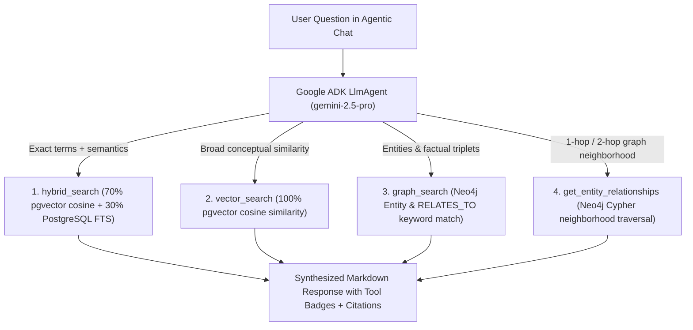

# Agentic Chat & Graph Tools

The chat subsystem uses **Google Agent Development Kit (`google-adk`)** and **Gemini (`gemini-2.5-pro`)** to reason across both **Neon PostgreSQL (`pgvector` + Full-Text Search)** and the **Neo4j Knowledge Graph**.

---

## Multi-Tool Agent Architecture (`app/agent.py`)

The root agent (`root_agent`) is an instance of `google.adk.agents.LlmAgent` configured with four specialized tools:



---

## The 4 Agent Tools in Detail

### 1. `hybrid_search(query, user_id, top_k=5)`
- **Backend Function**: `app/rag_store.py -> hybrid_search_documents()`
- **How It Works**: Embeds `query` with `gemini-embedding-001` (`768`-dim) and runs a single SQL query on Neon PostgreSQL combining cosine similarity (`0.7` weight) and English full-text rank `ts_rank_cd` (`0.3` weight).
- **Best For**: Technical questions, specific names, numbers, dates, and general factual questions over uploaded documents.

### 2. `vector_search(query, user_id, top_k=5)`
- **Backend Function**: `app/rag_store.py -> search_documents()`
- **How It Works**: Queries `document_chunks` ordered purely by `pgvector` cosine distance (`embedding <=> query_vec`).
- **Best For**: Conceptual, thematic, or paraphrased queries where exact keywords may not appear in the source text.

### 3. `graph_search(query, user_id, limit=15)`
- **Backend Function**: `app/graph_store.py -> search_knowledge_graph()`
- **How It Works**: Tokenizes the query and searches Neo4j `(:Entity)` names, categories, descriptions, and `[:RELATES_TO]` facts scoped to `user_id`.
- **Best For**: Discovering how people, organizations, technologies, models, and concepts connect across one or more documents.

### 4. `get_entity_relationships(entity_name, user_id, depth=1)`
- **Backend Function**: `app/graph_store.py -> get_entity_relationships_from_graph()`
- **How It Works**: Finds the matching `(:Entity)` node in Neo4j and traverses all incoming and outgoing `[:RELATES_TO]` edges plus `[:MENTIONED_IN]` document links.
- **Best For**: Deep-diving into a specific entity's direct connections and dependencies.

---

## Dynamic User Context Injection

To guarantee that the agent always queries only the signed-in user's data without asking the user for their ID, `build_agent_instruction(readonly_context: ReadonlyContext)` dynamically injects the authenticated `user_id` into the system prompt on every turn:

```python
def build_agent_instruction(readonly_context: ReadonlyContext) -> str:
    user_id = "default_user"
    if readonly_context and getattr(readonly_context, "session", None):
        user_id = getattr(readonly_context.session, "user_id", None) or "default_user"
    return (
        f"... The current authenticated user's `user_id` is EXACTLY: \"{user_id}\". "
        f"Whenever you call ANY tool, you MUST pass `user_id=\"{user_id}\"` ..."
    )
```

---

## Tool Execution Tracking & Dual Citations

In `app/api.py`, the `/chat` endpoint inspects the ADK event stream (`event.get_function_calls()`) during `runner.run_async(...)` and collects the ordered list of invoked tool names into `tools_used`:

```json
{
  "status": "success",
  "question": "How does the platform store vectors and knowledge graph facts?",
  "answer": "The platform stores 768-dimensional embeddings in Neon PostgreSQL [Source: architecture.md, chunk 0] and extracts entities into Neo4j [Graph: FastAPI Backend -> USES -> Neo4j].",
  "tools_used": ["hybrid_search", "graph_search"],
  "session_id": "session_a8b9c0",
  "user_id": "user_9f8e7d6c5b4a3210"
}
```

The frontend `ChatMessage.jsx` component renders:
- **Tool Execution Badges** at the top of the assistant message bubble (`hybrid_search`, `graph_search`)
- **Source Chunk Citations**: `[Source: filename, chunk N]`
- **Knowledge Graph Citations**: `[Graph: EntityA -> RELATION -> EntityB]`
