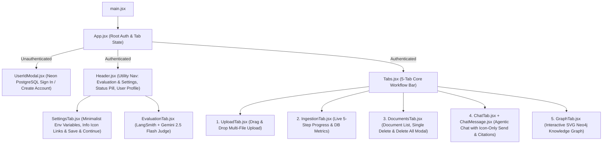

# Frontend Application Guide

The frontend (`frontend/`) is a **React 18 + Vite** single-page application styled with a **Bioluminescent Neural Forest Theme** (`#06120f` deep twilight pine canvas, `bg-neural-tree.jpg` Tree of Knowledge backdrop, translucent emerald glass cards, Bioluminescent Cyan `#22d3ee` and Firefly Root Gold `#fbbf24` accents) and an interactive SVG **Knowledge Graph Explorer**.

---

## Component Hierarchy

---

## Component Reference (`frontend/src/components/`)

| Component | File | Description |
|-----------|------|-------------|
| **Authentication Screen** | `UserIdModal.jsx` | Full Sign In / Create Account interface backed by `/auth/login` and `/auth/signup` on Neon PostgreSQL. |
| **Top Header** | `Header.jsx` | Sticky top bar displaying the application title, platform utility navigation (**Evaluation**, **Settings**), real-time `API Online` / `API Offline` indicator, signed-in user's name and email, and a **Sign Out** button. |
| **Tab Navigation** | `Tabs.jsx` | Five-tab core workflow bar ordered: `Upload` → `Ingestion Pipeline` → `Documents` → `Agentic Chat` → `Knowledge Graph`. |
| **Settings Tab (`v2.3.0` / `v2.3.3`)** | `SettingsTab.jsx` | Post-login landing screen displaying a minimalist grid of environment variable keys, input fields, and icon-only (`ⓘ`) documentation deep-links. Blank fields silently fall back to server defaults; clicking **Save & Continue** navigates to the **Upload** tab. |
| **Upload Tab** | `UploadTab.jsx` | Multi-file drag-and-drop and browser file selector supporting 13 document formats, with a numbered file queue, `+ Add More Files`, `Clear All`, individual file removal, and automatic redirection to the **Ingestion Pipeline** tab when batch ingestion begins. |
| **Ingestion Pipeline Tab** | `IngestionTab.jsx` | Polls `GET /ingest/progress` every `450ms` during single or multi-document uploads, displaying `Selected Document X of Y • Step S of 5 • <Step Name>` as the progress bar runs for each document, and summarizing total documents ingested (`All 5 Pipeline Steps Completed Successfully (Y Documents Ingested)`) with per-file metrics upon completion. |
| **Documents Tab (`v2.3.3`)** | `DocumentsTab.jsx` | Lists all documents owned by the user with chunk, entity, and relationship counts, per-document cascade delete, and a **Delete All** button that opens a confirmation modal requiring the user to type `Delete`. |
| **Agentic Chat Tab (`v2.3.3`)** | `ChatTab.jsx` & `ChatMessage.jsx` | Multi-turn chat interface with suggested starter prompts, an icon-only `<Send />` button, animated typing indicators, tool execution badges (`hybrid_search`, `vector_search`, `graph_search`, `get_entity_relationships`), and highlighted `[Source: ...]` / `[Graph: ...]` citations. |
| **Knowledge Graph Tab** | `GraphTab.jsx` | Interactive SVG radial/force-layout canvas for exploring Neo4j `:Entity` nodes and `:RELATES_TO` edges, complete with category filter pills, real-time keyword search, zoom controls, a 1-hop Entity Inspector drawer, and a structured triplets table. |
| **Evaluation Tab (`v2.4.0`)** | `EvaluationTab.jsx` | Generates grounded Golden Datasets from indexed documents, runs the ADK Agentic RAG pipeline, displays 5 aggregate metric cards (`Faithfulness`, `Context Relevance`, `Answer Correctness`, `Tool Routing`, `Citations`), links directly to LangSmith experiments, and provides expandable Gemini 2.5 Flash judge reasoning. |

---

## Design System (`frontend/src/index.css`)

The UI uses CSS custom properties defined in `frontend/src/index.css`:

| Token | Value | Purpose |
|-------|-------|---------|
| `--bg-primary` | `#06120f` | Deep twilight forest base canvas |
| `--bg-card` | `rgba(10, 27, 22, 0.82)` | Translucent blurred emerald-pine glass cards |
| `--border-subtle` | `rgba(52, 211, 153, 0.20)` | Subtle bioluminescent emerald border |
| `--accent-primary` | `#22d3ee` | Primary Bioluminescent Neural Cyan accent |
| `--accent-secondary` | `#fbbf24` | Secondary Firefly Root Gold accent |
| `--accent-success` | `#34d399` | Living Canopy Emerald (completed pipeline steps & online health badges) |
| `--accent-danger` | `#f87171` | Error alerts and delete actions |
| `--text-primary` | `#ecfdf5` | High-contrast bioluminescent mint-ivory primary text |
| `--text-secondary` | `#a7d7c5` | Soft sage-cyan secondary descriptions and metadata |

---

## API Client (`frontend/src/api.js`)

All HTTP calls are centralized in `frontend/src/api.js`:
- Automatically attaches `Authorization: Bearer <jwt_token>` from `localStorage`.
- Automatically clears expired sessions on `HTTP 401` and dispatches an `adk_auth_expired` window event so `App.jsx` smoothly returns the user to the Sign In page.
