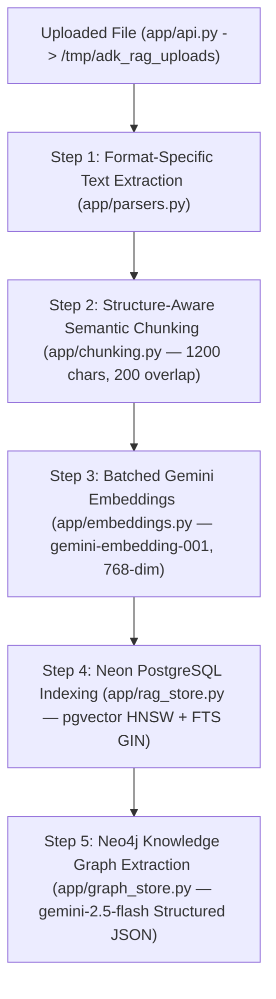

# Ingestion Pipeline

The 5-step dual ingestion pipeline converts raw uploaded files into both **searchable `768`-dimensional vector chunks in Neon PostgreSQL (`pgvector`)** and **structured entities and relationships in the Neo4j Knowledge Graph**, while streaming real-time step progress to the UI.

---

## 5-Step Dual Ingestion Overview



---

## Step 1: Format-Specific Text Extraction (`app/parsers.py`)

`parse_file(file_path)` inspects the lowercase file extension and routes the file to the appropriate parser:

| Extension | Library | Extraction Details |
|-----------|---------|--------------------|
| `.pdf` | `pymupdf` (`import pymupdf as fitz`) | Opens each page in sequence and extracts text blocks via `page.get_text("text")`. |
| `.docx` | `python-docx` | Extracts all non-empty paragraphs followed by all table rows formatted as `cell1 \| cell2`. |
| `.xlsx` | `openpyxl` | Loads workbook with `data_only=True` (evaluated formula values) and formats each sheet under `[Sheet: Name]`. |
| `.xls` | `xlrd` | Iterates legacy Excel sheets and formats non-empty rows. |
| `.pptx` | `python-pptx` | Extracts text frames and tables slide-by-slide under `[Slide N]`. |
| `.txt`, `.md`, `.log` | Built-in `open()` | Reads UTF-8 text directly. |
| `.csv` | `csv` | Joins each CSV row with `, `. |
| `.json` | `json` | Parses JSON and pretty-prints with `indent=2`. |
| `.xml`, `.html`, `.htm` | `xml.etree.ElementTree` / regex | Strips tags and normalizes whitespace into clean text. |

---

## Step 2: Structure-Aware Semantic Chunking (`app/chunking.py`)

Instead of slicing text at arbitrary character offsets (which breaks sentences and tables mid-thought), `chunk_text(text, chunk_size=1200, overlap=200)` preserves document structure:

1. **Line Normalization**: Converts `\r\n` to `\n` and collapses 3+ consecutive newlines into `\n\n`.
2. **Paragraph & Header Segmentation**: Splits along paragraph breaks (`\n\n`) and Markdown headings (`#`, `##`, `###`).
3. **Greedy Paragraph Packing**: Accumulates complete paragraphs into the current chunk as long as total length remains $\le 1200$ characters.
4. **Sentence-Boundary Fallback**: If a single paragraph exceeds `1200` characters, splits along sentence boundaries (`(?<=[.!?])\s+`).
5. **Contextual Overlap**: Carries the trailing `200` characters of chunk $i$ into the start of chunk $i+1$ so concepts spanning chunk boundaries remain intact.

---

## Step 3: Batched Gemini Embedding Generation (`app/embeddings.py`)

`get_embeddings_batch(texts, batch_size=50)` generates `768`-dimensional vectors for all chunks using `gemini-embedding-001`:

```python
response = client.models.embed_content(
    model="gemini-embedding-001",
    contents=batch,
    config=types.EmbedContentConfig(output_dimensionality=768),
)
```

Batching up to `50` chunks per API request significantly reduces ingestion latency compared to sequential per-chunk calls.

---

## Step 4: Neon PostgreSQL Vector + Full-Text Indexing (`app/rag_store.py`)

`add_document_chunks(...)` inserts the document metadata into `documents` and bulk-inserts all chunks into `document_chunks` using `psycopg2.extras.execute_values`:

- **Vector Index (`pgvector` HNSW)**: Indexes `embedding vector_cosine_ops` for fast cosine similarity search.
- **Full-Text Index (PostgreSQL GIN)**: Indexes `to_tsvector('english', content)` for keyword and phrase matching.

---

## Step 5: Neo4j Knowledge Graph Extraction (`app/graph_store.py`)

`add_document_to_graph(...)` extracts domain entities and factual relationships from the chunks and merges them into Neo4j:

1. **Structured LLM Extraction**:
   - Sends batches of `4` chunks to `gemini-2.5-flash` configured with `response_mime_type="application/json"` and `response_schema=ChunkGraphExtraction`.
   - Extracts canonical `ExtractedEntity` nodes (`name`, `category`, `description`) and `ExtractedRelationship` edges (`source`, `target`, `relation_type`, `fact`).
2. **Neo4j Cypher Persistence**:
   - Creates/merges the `(:Document {id: user_id::document_id})` node.
   - Merges each `(:Entity {id: user_id::lower(name)})` node and links `(e)-[:MENTIONED_IN]->(d)`.
   - Merges directed `(source:Entity)-[:RELATES_TO {relation_type, document_id, user_id}]->(target:Entity)` edges storing the supporting `fact`.
3. **Metadata Sync**:
   - Updates `documents.entities_count` and `documents.relationships_count` in Neon PostgreSQL so the **Documents** tab displays accurate counts for every file.

---

## Live Per-User Progress Tracking (`app/ingest.py`)

During ingestion, `ingest_document()` updates an in-memory per-user state dictionary (`_user_ingestion_progress[user_id]`) before and after each of the 5 steps.

The frontend polls `GET /ingest/progress` every `800ms` while an upload is active, receiving:

```json
{
  "active": true,
  "filename": "architecture_overview.pdf",
  "current_step": 3,
  "error": null,
  "steps": {
    "1": { "status": "completed", "detail": "Extracted 14,820 characters" },
    "2": { "status": "completed", "detail": "Created 15 semantic chunks" },
    "3": { "status": "running", "detail": "Generating 768-dim vectors for 15 chunks..." },
    "4": { "status": "pending", "detail": "Waiting" },
    "5": { "status": "pending", "detail": "Waiting" }
  }
}
```
