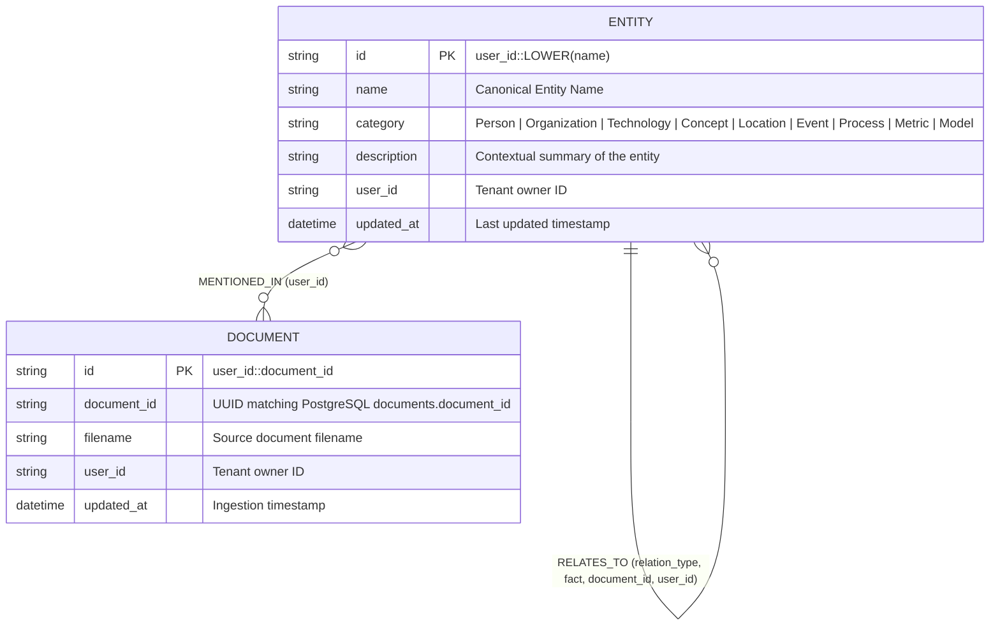

# Technical Specifications

This document provides the complete engineering and technical specifications for the **ADK Agentic RAG + Knowledge Graph** platform, including technology versions, database schemas, cryptographic authentication parameters, retrieval scoring formulas, structured extraction schemas, and runtime configurations.

---

## 1. Technology Stack Matrix

| Layer | Component | Technology / Package | Version / Model | Purpose |
|-------|-----------|----------------------|-----------------|---------|
| **Backend Runtime** | Language | Python | `3.10+` (`3.12` recommended) | Core backend runtime |
| **API Server** | Web Framework | FastAPI + Uvicorn | `fastapi >= 0.110`, `uvicorn[standard]` | Async REST API & OpenAPI documentation |
| **Agent Framework** | Orchestration | Google Agent Development Kit (`google-adk`) | Latest (`LlmAgent`, `Runner`, `InMemorySessionService`) | Multi-tool agent reasoning & session management |
| **Reasoning LLM** | Agent Model | Google Gemini (`google-genai`) | `gemini-2.5-pro` (configurable via `AGENT_MODEL`) | Tool selection, multi-hop synthesis, cited responses |
| **Graph Extraction LLM** | Structured Output Model | Google Gemini (`google-genai`) | `gemini-2.5-flash` (configurable via `GRAPH_EXTRACTION_MODEL`) | Fast JSON schema extraction of entities & relationships |
| **Embeddings** | Embedding Model | Google Gemini (`google-genai`) | `gemini-embedding-001` (`768` dimensions) | Dense semantic vector representation of chunks & queries |
| **Relational + Vector DB** | Primary Database | Neon Console Serverless PostgreSQL | PostgreSQL 15/16 + `pgvector` (`vector` extension) | User auth, document metadata, vector search, full-text search |
| **Postgres Driver** | DB Client | `psycopg2-binary` + `pgvector` | `psycopg2-binary >= 2.9`, `pgvector >= 0.2.5` | Threaded connection pooling & vector type registration |
| **Knowledge Graph DB** | Graph Database | Neo4j AuraDB / Neo4j 5+ | Neo4j `5.x` (`neo4j >= 5.18`) | Entity nodes, relationship triplets, multi-hop Cypher traversal |
| **Authentication** | Password + Token | Python `hashlib` + `hmac` | `PBKDF2-HMAC-SHA256` + `HS256` JWT | Stateless Bearer authentication backed by Neon PostgreSQL |
| **Frontend UI** | Web Client | React + Vite | React `18.3`, Vite `5.x` | Clean Modern SaaS Light UI & interactive SVG Knowledge Graph |

---

## 2. Database Specifications

### 2.1 Neon Console PostgreSQL (`pgvector` + Full-Text Search)

The PostgreSQL database is initialized automatically at startup by `app/database.py` (reference DDL in `sql/schema.sql`).

#### Extensions Required
```sql
CREATE EXTENSION IF NOT EXISTS vector;
```

#### Table 1: `users` (Authentication & Multi-Tenancy)
Stores registered user accounts for Neon PostgreSQL Authentication.

| Column | Type | Constraints | Description |
|--------|------|-------------|-------------|
| `user_id` | `TEXT` | `PRIMARY KEY` | Unique identifier (`user_<16-hex-chars>`) |
| `email` | `TEXT` | `UNIQUE NOT NULL` | Normalized lowercase email address |
| `name` | `TEXT` | `NOT NULL` | User's display name |
| `password_hash` | `TEXT` | `NOT NULL` | `<salt_hex>:<pbkdf2_sha256_hex>` |
| `created_at` | `TIMESTAMPTZ` | `DEFAULT NOW()` | Account creation timestamp |

#### Table 2: `documents` (Ingested Document Registry)
Stores per-document metadata and summary counts.

| Column | Type | Constraints | Description |
|--------|------|-------------|-------------|
| `document_id` | `TEXT` | `PRIMARY KEY` | UUID v4 string |
| `user_id` | `TEXT` | `NOT NULL` | Owner's `user_id` |
| `filename` | `TEXT` | `NOT NULL` | Original uploaded filename |
| `file_type` | `TEXT` | `NOT NULL` | Lowercase file extension (e.g., `.pdf`) |
| `chunks_count` | `INTEGER` | `DEFAULT 0` | Number of chunks stored in `document_chunks` |
| `entities_count` | `INTEGER` | `DEFAULT 0` | Number of entities extracted into Neo4j |
| `relationships_count` | `INTEGER` | `DEFAULT 0` | Number of relationships extracted into Neo4j |
| `created_at` | `TIMESTAMPTZ` | `DEFAULT NOW()` | Upload timestamp |

#### Table 3: `document_chunks` (Vector & Full-Text Store)
Stores structure-aware semantic text chunks and `768`-dimensional Gemini embeddings.

| Column | Type | Constraints | Description |
|--------|------|-------------|-------------|
| `chunk_id` | `TEXT` | `PRIMARY KEY` | `<document_id>_chunk_<index>` |
| `document_id` | `TEXT` | `NOT NULL REFERENCES documents(document_id) ON DELETE CASCADE` | Parent document reference |
| `user_id` | `TEXT` | `NOT NULL` | Owner's `user_id` for filtered retrieval |
| `filename` | `TEXT` | `NOT NULL` | Source document filename |
| `chunk_index` | `INTEGER` | `NOT NULL` | Zero-based sequential chunk index |
| `content` | `TEXT` | `NOT NULL` | Raw text content of the chunk |
| `embedding` | `VECTOR(768)` | `NOT NULL` | 768-dimensional float vector from `gemini-embedding-001` |
| `metadata` | `JSONB` | `DEFAULT '{}'::jsonb` | Extensible JSON metadata (`file_type`, `char_length`) |
| `created_at` | `TIMESTAMPTZ` | `DEFAULT NOW()` | Creation timestamp |

#### PostgreSQL Indexes

| Index Name | Target | Index Type | Specification |
|------------|--------|------------|---------------|
| `idx_Users_Email` | `users(email)` | B-Tree | Fast login lookup by email |
| `idx_Documents_User` | `documents(user_id)` | B-Tree | Fast per-user document listing |
| `idx_Chunks_User` | `document_chunks(user_id)` | B-Tree | Pre-filtering chunks by tenant |
| `idx_Chunks_Document` | `document_chunks(document_id)` | B-Tree | Fast cascade join & lookup |
| `idx_Chunks_Embedding_HNSW` | `document_chunks USING hnsw (embedding vector_cosine_ops)` | `pgvector` HNSW | Approximate nearest-neighbor cosine similarity search |
| `idx_Chunks_Content_FTS` | `document_chunks USING gin (to_tsvector('english', content))` | GIN (`tsvector`) | Fast English full-text lexical search |

#### Connection Pool Specification (`app/database.py`)
- **Pool Class**: `psycopg2.pool.ThreadedConnectionPool(minconn=1, maxconn=10)`
- **Serverless Keepalives**:
  - `keepalives = 1`
  - `keepalives_idle = 30` seconds
  - `keepalives_interval = 10` seconds
  - `keepalives_count = 5`
- **Health Check on Checkout**: Executes `SELECT 1` before yielding a pooled connection; transparently replaces stale connections closed by Neon serverless autosuspend.
- **URL Normalization**: `_normalize_database_url()` automatically repairs malformed query delimiters (such as missing `?` before `sslmode=require`).

---

### 2.2 Neo4j Knowledge Graph Data Model

The Neo4j graph stores structured domain entities and factual relationships scoped per user.



#### Neo4j Constraints & Indexes
```cypher
CREATE CONSTRAINT entity_unique_id IF NOT EXISTS
FOR (e:Entity) REQUIRE e.id IS UNIQUE;

CREATE INDEX entity_user_idx IF NOT EXISTS
FOR (e:Entity) ON (e.user_id);

CREATE INDEX entity_name_idx IF NOT EXISTS
FOR (e:Entity) ON (e.name);

CREATE CONSTRAINT doc_unique_id IF NOT EXISTS
FOR (d:Document) REQUIRE d.id IS UNIQUE;
```

---

## 3. Authentication & Security Specifications (`app/auth.py`)

### 3.1 Password Hashing
- **Algorithm**: `PBKDF2-HMAC-SHA256`
- **Iterations**: `260,000` (OWASP-recommended work factor)
- **Salt**: `16` bytes (`32` hex characters) generated via `secrets.token_hex(16)` per user
- **Storage Format**: `<salt_hex>:<derived_key_hex>` stored in `users.password_hash`
- **Verification**: Constant-time comparison via `hmac.compare_digest()` to prevent timing attacks

### 3.2 JWT Bearer Token
- **Signing Algorithm**: `HS256` (`HMAC-SHA256` signed with `JWT_SECRET_KEY`)
- **Default Expiration**: `168` hours (`7` days, configurable via `JWT_EXPIRE_HOURS`)
- **Token Payload Structure**:
  ```json
  {
    "sub": "user_9f8e7d6c5b4a3210",
    "email": "alice@company.com",
    "name": "Alice Morgan",
    "iat": 1730910000,
    "exp": 1731514800
  }
  ```
- **Transport**: Sent by the React client in the `Authorization: Bearer <token>` HTTP header.

---

## 4. Document Processing, Chunking & Embedding Specifications

### 4.1 Supported File Formats (`app/parsers.py`)

| Extension | Format | Parser Library | Extraction Behavior |
|-----------|--------|----------------|---------------------|
| `.pdf` | PDF Document | `pymupdf` (`fitz`) | Extracts text page-by-page in reading order |
| `.docx` | Word Document | `python-docx` | Extracts paragraphs and table cells (`\|`-delimited rows) |
| `.xlsx` | Excel Workbook | `openpyxl` (`data_only=True`) | Iterates sheets and rows, outputting `[Sheet: Name]` blocks |
| `.xls` | Legacy Excel | `xlrd` | Iterates legacy workbook sheets and rows |
| `.pptx` | PowerPoint | `python-pptx` | Extracts slide titles, text frames, and table cells per slide |
| `.txt`, `.md`, `.log` | Plain Text / Markdown | Python `open(..., encoding="utf-8", errors="ignore")` | Direct UTF-8 text reading |
| `.csv` | Comma-Separated Values | Python `csv` | Row-by-row text formatting |
| `.json` | JSON Data | Python `json` | Parses and pretty-prints with `indent=2` |
| `.xml`, `.html`, `.htm` | Markup Documents | `xml.etree.ElementTree` / regex tag stripper | Strips markup tags and normalizes whitespace |

### 4.2 Structure-Aware Semantic Chunking (`app/chunking.py`)
- **Target Chunk Size (`chunk_size`)**: `1,200` characters
- **Sliding Window Overlap (`overlap`)**: `200` characters
- **Splitting Hierarchy**:
  1. Normalizes `\r\n` line endings and collapses excessive blank lines (`\n{3,}` → `\n\n`).
  2. Splits text into structural blocks along double newlines (`\n\n`) and Markdown headings (`#`, `##`, `###`).
  3. Packs whole paragraphs together up to `1,200` characters.
  4. If a single paragraph exceeds `1,200` characters, splits along sentence boundaries (`(?<=[.!?])\s+`) before falling back to hard character slicing.
  5. Carries over the trailing `200` characters of the previous chunk to preserve cross-chunk context.

### 4.3 Vector Embeddings (`app/embeddings.py`)
- **Model**: `gemini-embedding-001`
- **Dimensionality**: `768` (`EmbedContentConfig(output_dimensionality=768)`)
- **Batching**: Up to `50` chunks per `embed_content` API call to minimize network round-trips during document upload.

---

## 5. Retrieval & Hybrid Search Scoring Specification (`app/rag_store.py`)

### 5.1 Pure Vector Search (`search_documents`)
Computes cosine similarity in PostgreSQL using the `pgvector` `<=>` cosine distance operator:

$$\text{vector\_similarity}(c, q) = 1 - \left( \mathbf{e}_c \iff \mathbf{e}_q \right)$$

where $\mathbf{e}_c, \mathbf{e}_q \in \mathbb{R}^{768}$ are the normalized chunk and query embeddings.

### 5.2 Hybrid Vector + Full-Text Search (`hybrid_search_documents`)
Combines semantic cosine similarity (`70%` weight) with PostgreSQL English cover-density full-text rank (`30%` weight):

$$\text{keyword\_score}(c, q) = \text{ts\_rank\_cd}\left(\text{to\_tsvector}(\text{'english'}, c.\text{content}),\ \text{plainto\_tsquery}(\text{'english'}, q)\right)$$

$$\text{combined\_score}(c, q) = 0.7 \times \text{vector\_similarity}(c, q) + 0.3 \times \text{keyword\_score}(c, q)$$

Results are filtered strictly by `user_id` and ordered by `combined_score DESC LIMIT top_k`.

---

## 6. Knowledge Graph Extraction Specification (`app/graph_store.py`)

During Step 5 of ingestion, document chunks are batched (`batch_size = 4`, up to `25` chunks per document) and sent to `gemini-2.5-flash` with `response_mime_type="application/json"` and `temperature=0.1`.

### Structured Output Schema (`ChunkGraphExtraction`)

```python
class ExtractedEntity(BaseModel):
    name: str          # Canonical entity name (e.g., "Google ADK", "PostgreSQL")
    category: str      # Person | Organization | Technology | Concept | Location | Event | Process | Metric | Model
    description: str   # Concise 1-sentence summary in context

class ExtractedRelationship(BaseModel):
    source: str        # Exact name of source entity
    target: str        # Exact name of target entity
    relation_type: str # UPPER_SNAKE_CASE verb (e.g., "USES", "DEPENDS_ON", "BUILT_BY")
    fact: str          # Concise factual sentence explaining how source relates to target

class ChunkGraphExtraction(BaseModel):
    entities: List[ExtractedEntity]
    relationships: List[ExtractedRelationship]
```

---

## 7. API Endpoint Specifications (`app/api.py`)

| Method | Path | Auth Required | Request Body / Params | Response Summary |
|--------|------|---------------|-----------------------|------------------|
| `GET` | `/health` | No | None | `{"status": "ok", "service": "ADK Agentic RAG + Knowledge Graph API"}` |
| `POST` | `/auth/signup` | No | `{"email", "name", "password"}` | `{"status": "success", "token": "<jwt>", "user": {...}}` |
| `POST` | `/auth/login` | No | `{"email", "password"}` | `{"status": "success", "token": "<jwt>", "user": {...}}` |
| `GET` | `/auth/me` | Bearer JWT | None | `{"status": "ok", "user": {"user_id", "email", "name"}}` |
| `GET` | `/ingest/status` | Bearer JWT | None | Vector & Graph connectivity, counts, model names, supported formats |
| `GET` | `/ingest/progress` | Bearer JWT | None | Live step-by-step ingestion state (`active`, `current_step`, `steps[1..5]`) |
| `POST` | `/documents/upload` | Bearer JWT | `multipart/form-data` (`file`) | Ingestion result (`document_id`, `chunks_created`, `entities_extracted`, `relationships_extracted`) |
| `GET` | `/documents` | Bearer JWT | None | List of user's documents with chunk/entity/relationship counts |
| `DELETE` | `/documents/{document_id}` | Bearer JWT | Path param `document_id` | Cascade deletion counts across Neon PostgreSQL & Neo4j |
| `GET` | `/graph` | Bearer JWT | Query param `limit` (default `150`) | `{nodes, edges, stats}` for interactive UI visualization |
| `GET` | `/graph/entity/{entity_name}` | Bearer JWT | Path param `entity_name`, `depth` | 1-hop incoming/outgoing relationships for an entity |
| `POST` | `/chat` | Bearer JWT | `{"question", "session_id"}` | `{"answer", "tools_used", "session_id", "user_id"}` |

---

## 8. Environment Variable Specifications (`.env`)

| Variable | Required | Default | Description |
|----------|----------|---------|-------------|
| `GOOGLE_API_KEY` | **Yes** | — | Google Gemini API key from Google AI Studio |
| `DATABASE_URL` | **Yes** | — | Neon Console PostgreSQL connection URI (`postgresql://...?sslmode=require`) |
| `NEO4J_URI` | **Yes** | `bolt://localhost:7687` | Neo4j AuraDB (`neo4j+s://...`) or local Bolt URI |
| `NEO4J_USERNAME` | **Yes** | `neo4j` | Neo4j username |
| `NEO4J_PASSWORD` | **Yes** | — | Neo4j password |
| `NEO4J_DATABASE` | No | `neo4j` | Target Neo4j database name |
| `JWT_SECRET_KEY` | No | Auto-default | Secret key for signing `HS256` JWT tokens |
| `JWT_EXPIRE_HOURS` | No | `168` | JWT token validity period in hours |
| `AGENT_MODEL` | No | `gemini-2.5-pro` | Gemini model used by the Google ADK reasoning agent |
| `GRAPH_EXTRACTION_MODEL` | No | `gemini-2.5-flash` | Gemini model used for structured entity/relationship extraction |
| `TOP_K` | No | `5` | Default number of chunks returned by vector and hybrid search |
