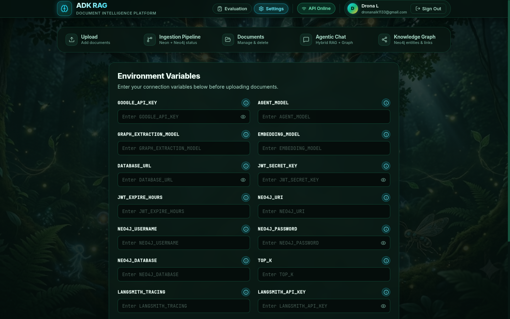
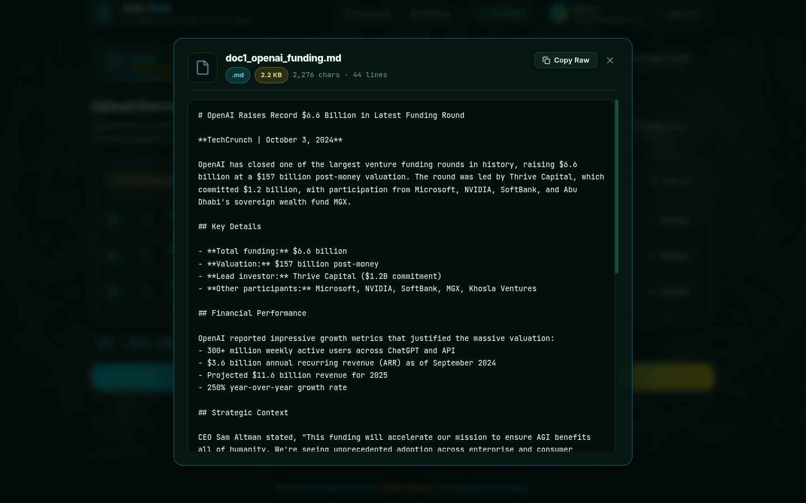
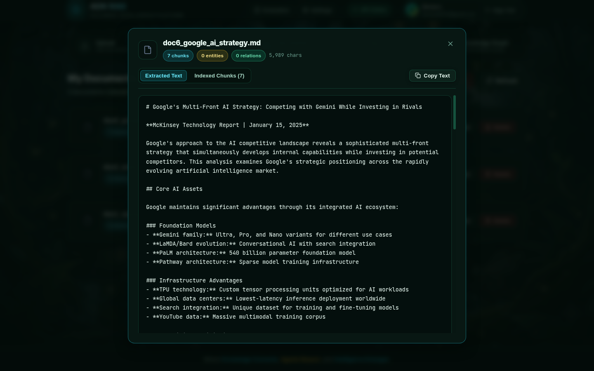
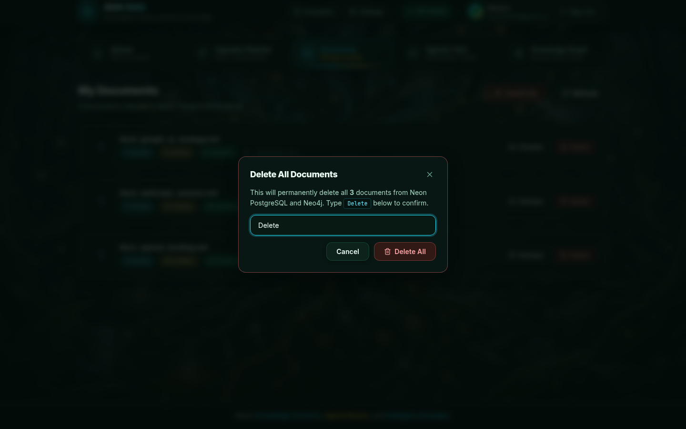
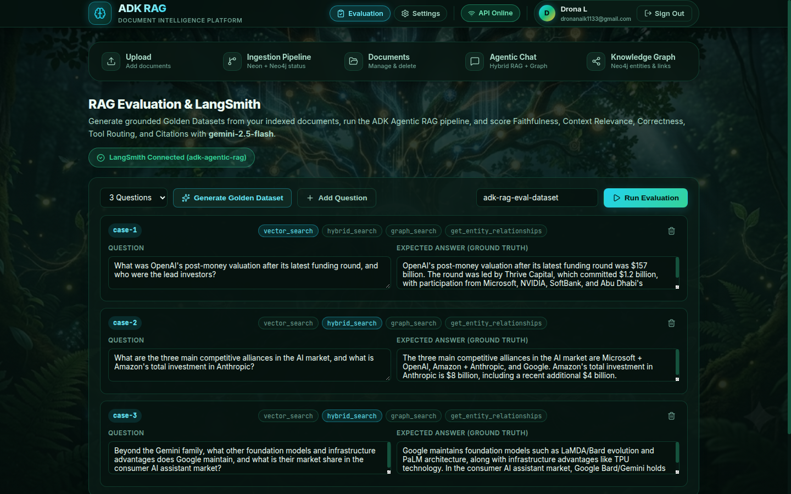
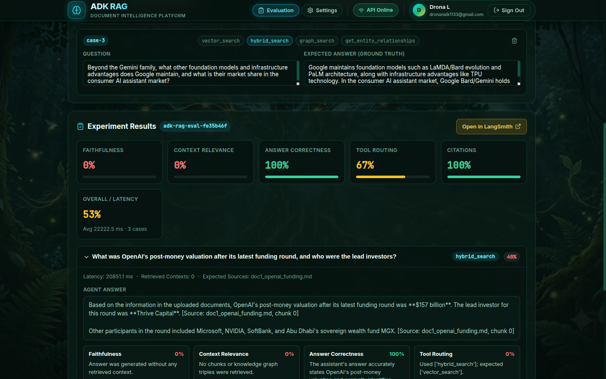

# :material-book-open-page-variant: Interactive User Guide

This step-by-step visual guide walks you through every view and interaction in the **ADK Agentic RAG + Knowledge Graph** platform—from signing in with **Neon PostgreSQL Authentication** to configuring environment variables, uploading documents, monitoring the live 5-step hybrid ingestion pipeline, managing indexed documents, querying the **Google ADK Agent**, inspecting your **Neo4j Knowledge Graph**, and evaluating RAG quality with **LangSmith & Gemini 2.5 Flash**.

<video src="../adk_rag.mp4" width="100%" controls autoplay loop muted style="border-radius: 12px; border: 1px solid rgba(52, 211, 153, 0.3); margin-top: 12px;"></video>

---

## :material-map-marker-path: End-to-End User Workflow

```mermaid
flowchart LR
    A["1. Authentication (Sign In / Create Account)"] --> S["2. Settings (Env Variables & Docs Info Links)"]
    S --> B["3. Document Upload (Dropzone & File Preview)"]
    B --> C["4. Hybrid Ingestion (Lossless Docling + Vision)"]
    C --> D["5. Document Manager (Delete & Delete All Modal)"]
    D --> E["6. Agentic Chat (4 Tools & Dual Citations)"]
    E --> F["7. Knowledge Graph (Topology & 1-Hop Inspector)"]
    F --> G["8. RAG Evaluation & LangSmith (Gemini 2.5 Flash Judge)"]
```

-   :material-shield-account:{ .lg .middle } **Authentication & Workspace Isolation**

    ---

    Sign in or register an isolated multi-tenant workspace backed by **Neon PostgreSQL** (`PBKDF2-HMAC-SHA256` + `HS256` JWT).

    [:octicons-arrow-down-24: Jump to Authentication](#step-1-create-an-account-or-sign-in)

-   :material-cog-outline:{ .lg .middle } **Environment Variables (`Settings` Header Button)**

    ---

    Post-login configuration screen in the top header with minimalist key inputs, `ⓘ` documentation links, and silent fallback to default values when left blank.

    [:octicons-arrow-down-24: Jump to Environment Settings](#step-1b-configure-environment-variables-settings-in-top-header)

-   :material-cloud-upload:{ .lg .middle } **Document Upload**

    ---

    Drag and drop files across 13 supported formats, preview file metadata, and launch hybrid ingestion.

    [:octicons-arrow-down-24: Jump to Document Upload](#step-2-uploading-one-or-multiple-documents-upload-tab)

-   :material-progress-check:{ .lg .middle } **Live 5-Step Ingestion Pipeline**

    ---

    Watch real-time step-by-step execution across lossless Docling + Gemini Vision extraction, chunking, Gemini embeddings, Neon `pgvector`, and Neo4j.

    [:octicons-arrow-down-24: Jump to Ingestion Pipeline](#step-3-monitoring-the-live-5-step-ingestion-pipeline-ingestion-pipeline-tab)

-   :material-folder-multiple-outline:{ .lg .middle } **Document Management**

    ---

    Inspect per-document vector chunk, entity, and relationship counts, delete single files, or use the **Delete All** modal (`Delete` confirmation).

    [:octicons-arrow-down-24: Jump to Document Management](#step-4-managing-indexed-documents-documents-tab)

-   :material-forum:{ .lg .middle } **Agentic RAG + Graph Chat**

    ---

    Query the **Google ADK `LlmAgent`** with autonomous tool selection (`hybrid_search`, `graph_search`) and `[Source]` / `[Graph]` citations.

    [:octicons-arrow-down-24: Jump to Agentic Chat](#step-5-asking-questions-in-agentic-chat-agentic-chat-tab)

-   :material-graph:{ .lg .middle } **Neo4j Knowledge Graph Explorer**

    ---

    Explore the interactive Neo4j SVG entity topology, filter by category, and click any node to inspect its 1-hop neighborhood.

    [:octicons-arrow-down-24: Jump to Knowledge Graph](#step-6-exploring-the-neo4j-knowledge-graph-knowledge-graph-tab)

-   :material-chart-box-outline:{ .lg .middle } **RAG Evaluation & LangSmith**

    ---

    Generate synthetic Q&A golden datasets from your indexed documents and score RAG runs with **Gemini 2.5 Flash** LLM-as-a-Judge across 5 metrics.

    [:octicons-arrow-down-24: Jump to RAG Evaluation](#step-7-evaluating-rag-quality-evaluation-in-top-header)

---

## Step 1: Create an Account or Sign In

When you open the application (`http://localhost:5173`), the **Bioluminescent Neural Forest Authentication Modal** appears in front of the Tree of Knowledge backdrop. Every account is stored in the **Neon PostgreSQL `users` table** and issues an `HS256` signed JWT Bearer token.

### Sign In to an Existing Workspace

1. Select the **Sign In** tab on the authentication modal.
2. Enter your registered **Email Address** (e.g., `dronanaik1133@gmail.com`) and **Password**.
3. Click **Sign In to Workspace →** to authenticate against `POST /auth/login` and enter your isolated workspace.

---

### Create a New Account

1. Select the **Create Account** tab on the authentication card.
2. Fill in your registration details:
   - **Full Name**: Your display name shown in the top workspace header.
   - **Email Address**: Your unique workspace identifier (`user_id`).
   - **Password**: Minimum 6 characters, hashed using `PBKDF2-HMAC-SHA256` before storage in Neon PostgreSQL.
3. Click **Create Account & Continue →** to register via `POST /auth/signup` and automatically sign in.

!!! info "Strict Multi-Tenant Data Isolation"
    Every document you upload, every `768`-dimensional vector chunk stored in **Neon PostgreSQL**, and every `:Entity` / `:RELATES_TO` record created in **Neo4j** is strictly scoped to your authenticated `user_id`. No other user can view or query your workspace data.

---

## Step 1b: Configure Environment Variables (`Settings` in Top Header)

Immediately after signing in, you land on **Settings** (`SettingsTab.jsx`), which lives in the **top header bar** alongside **Evaluation**—keeping the main navigation bar focused on the 5 core workflow tabs (**Upload** → **Ingestion Pipeline** → **Documents** → **Agentic Chat** → **Knowledge Graph**).

1. **Minimalist Variable Grid**: Each card displays **only** the environment variable key name (`GOOGLE_API_KEY`, `AGENT_MODEL`, `GRAPH_EXTRACTION_MODEL`, `EMBEDDING_MODEL`, `DATABASE_URL`, `JWT_SECRET_KEY`, `JWT_EXPIRE_HOURS`, `NEO4J_URI`, `NEO4J_USERNAME`, `NEO4J_PASSWORD`, `NEO4J_DATABASE`, `TOP_K`), an input field, and an info icon (`ⓘ`).
2. **Documentation Deep-Link (`ⓘ`)**: Clicking the **`ⓘ`** icon next to any variable opens the exact step-by-step guide in [Installation & Environment Setup](INSTALLATION.md) explaining how to obtain that key.
3. **Silent Default Fallback**: Default values are never exposed in the UI. Leaving any input blank automatically falls back to the server's default configuration in the background.
4. Click **Save & Continue** to apply your configuration and automatically navigate to the **Upload** tab.

---

## Step 2: Uploading One or Multiple Documents (`Upload` Tab)

Once your settings are saved, you transition to the **Upload** tab (`UploadTab.jsx`).

### Upload Documents Dropzone

1. Drag and drop **one or multiple files** onto the dashed bioluminescent dropzone, or click **click to browse multiple files** to open your system file picker.
2. All **13 supported file extensions** are displayed as badges below the dropzone: `.pdf`, `.docx`, `.xlsx`, `.xls`, `.pptx`, `.txt`, `.md`, `.csv`, `.json`, `.xml`, `.html`, `.htm`, and `.log`.

---

### Multi-Document Queue Selected & Ready to Ingest

1. Once one or more files are selected (e.g., `doc1_openai_funding.md`, `doc2_anthropic_amazon.md`, and `doc6_google_ai_strategy.md`), the dropzone transforms into an interactive **Multi-Document Queue Card** displaying:
   - **Selected Count & Total Size Badge**: e.g., `3 Documents Selected` (`Total: 10.9 KB`).
   - **Queue Controls**: Click **+ Add More Files** to append additional documents to the batch, or **Clear All** to reset the queue.
   - **Numbered File Preview Rows**: Each queued document shows its batch order (`1`, `2`, `3`…), format-specific icon, clickable **filename**, formatted **file size**, a **Preview** button (`#upload-preview-<idx>`) to inspect the raw file before ingestion (client-side text preview + Copy Raw for `.txt`/`.md`/`.csv`/`.json`/`.xml`/`.html`/`.log`, embedded PDF viewer for `.pdf`, and metadata summary for binary Office files), and an individual **× Remove** button.
2. Click **Preview** (or click the queued filename) to inspect the raw file in the **Raw File Preview Modal** before starting ingestion:

3. Click the primary gradient button **Ingest 3 Documents into Neon Postgres & Neo4j** (or **Ingest into Neon Postgres & Neo4j** for a single file) at the bottom of the view to launch the 5-step hybrid ingestion pipeline.

---

## Step 3: Monitoring the Live 5-Step Ingestion Pipeline (`Ingestion Pipeline` Tab)

Clicking the **Ingest** button automatically transitions you to the **Ingestion Pipeline** tab (`IngestionTab.jsx`), which processes each queued document sequentially through all 5 stages while polling `GET /ingest/progress` every `450ms`.

### Live Per-Document 5-Step Hybrid Ingestion Execution

While documents are actively being processed:

- **Per-Document Live Progress Banner**:
  - When multiple documents are selected, the header badge displays **`SELECTED DOCUMENT 2 OF 3 • STEP S OF 5 • <STEP NAME>`** along with a **`Doc 2 / 3`** indicator and the per-document percentage progress bar (`0%` → `100%` for each file).
  - For a single document, it displays **`STEP S OF 5 • <STEP NAME>`**.
- **Database Status Cards**: Real-time counters for **Neon Postgres Status** (`Ready`), **Vector Chunks Stored**, **Neo4j Entities**, and **Neo4j Relationships** update as each document finishes.
- **Active vs. Queued Step Badges**:
  - The currently executing stage highlights with a glowing cyan border and a **`Running Now...`** spinner badge.
  - Upcoming stages remain in the **`Queued`** state until the active stage completes.

---

### Completed Batch Ingestion Summary & Stage Logs

When all queued documents finish executing all 5 stages:

1. **Emerald Completion Banner (`All 5 Pipeline Steps Completed Successfully (3 Documents Ingested)`)**:
   - Explicitly displays the total number of ingested documents when a multi-file batch completes.
   - Summarizes aggregated metrics across the batch (**Documents Ingested: `3`**, **Filenames**, **Chunks (pgvector): `13`**, **Entities (Neo4j): `126`**, **Relationships (Neo4j): `118`**, and **Characters: `11,205`**).
   - Lists a **Per-Document Breakdown** (`✓ 1. doc1_openai_funding.md`, `✓ 2. doc2_anthropic_amazon.md`, `✓ 3. doc6_google_ai_strategy.md`) with each file's individual chunk, entity, and relationship counts.
2. **Updated Database Counters**: The 4 workspace metric cards immediately reflect the updated totals in Neon PostgreSQL and Neo4j.
3. **Per-Stage Output Logs**: All 5 pipeline cards show green **`✓ Completed`** badges along with their concrete stage output for the completed run.

!!! tip "Automatic Redundant & Updated File Upload Handling (`v2.1.1`)"
    The ingestion pipeline computes a normalized **SHA-256 content fingerprint** (`content_hash`) for every uploaded file and automatically handles redundant or updated uploads:

    - **Exact Same File Uploaded Again (`Skipped (Already Indexed)`)**: Skips redundant Gemini embedding and Neo4j extraction calls and reuses your existing indexed document.
    - **Same Content with a Different Filename (`Skipped (Duplicate of <filename>)`)**: Prevents duplicate chunks from skewing vector similarity scores and points to the existing filename.
    - **Updated Version of an Existing File (`Updated Version`)**: Atomically purges the old version's chunks from **Neon PostgreSQL** and its relationships/orphaned entities from **Neo4j** before indexing the updated document.

---

## Step 4: Managing Indexed Documents (`Documents` Tab)

Switch to the **Documents** tab (`DocumentsTab.jsx`) to audit your indexed files or remove documents from your workspace.

### Indexed Documents List

Each indexed document card displays:

- **Filename & Format Icon**: e.g., `doc6_google_ai_strategy.md`, `doc2_anthropic_amazon.md`, and `doc1_openai_funding.md`
- **Neon PostgreSQL Vector Count Badge**: e.g., `7 chunks`, `3 chunks` (cyan badge)
- **Neo4j Entity Count Badge**: e.g., `55 entities`, `31 entities`, `33 entities` (gold badge)
- **Neo4j Relationship Count Badge**: e.g., `52 relations`, `31 relations`, `33 relations` (emerald badge)
- **Document UUID**: Truncated `doc_id` (`ID: 3cff2396-097...`)
- **Preview, Refresh & Delete Controls**: Top-right **Refresh** button, per-document **Preview** button (and clickable filename), and per-document **Delete** button.

---

### Document Content Preview Modal (`v2.4.1`)

Click **Preview** (or click any document's filename) to inspect its indexed content in a modal without leaving the **Documents** tab:

1. **Extracted Text View**: Displays the full reconstructed text extracted during ingestion (`GET /documents/{document_id}/preview`) along with a one-click **Copy Text** button.
2. **Indexed Chunks View**: Switch to **Indexed Chunks (`N`)** to inspect every vector chunk stored in **Neon PostgreSQL** with its chunk number and character count.

---

### Atomic Cascade Delete & Bulk "Delete All" Confirmation Modal (`v2.3.3`)

1. **Single-Document Delete**: Clicking **Delete** on any document card reveals an inline confirmation bar: **`Delete from Postgres & Neo4j?`** with **Yes, delete** and **Cancel** buttons. Clicking **Yes, delete** invokes `DELETE /documents/{doc_id}` to atomically remove the document's chunks from **Neon PostgreSQL** and its relationships/orphaned entities from **Neo4j**.

2. **Bulk "Delete All" with Type-to-Confirm Popup (`Delete`)**:
   - Clicking the **Delete All** button in the top-right header opens a modal dialog (`Delete All Documents`).
   - To prevent accidental data loss, the **Delete All** action button remains disabled until you type **`Delete`** into the confirmation input field.
   - Confirming invokes `DELETE /documents`, wiping all documents, vector chunks, and Knowledge Graph entities/relationships for your user account across both **Neon PostgreSQL** and **Neo4j**.

---

## Step 5: Asking Questions in Agentic Chat (`Agentic Chat` Tab)

Switch to the **Agentic Chat** tab (`ChatTab.jsx`) to converse with the **Google ADK `LlmAgent`** powered by **Gemini 2.5 Pro**.

### Starter Prompts & New Session View

When starting a new session:

- Four clickable **Starter Question Pills** let you immediately test hybrid vector + graph retrieval:
  1. *"Summarize the key concepts and how they relate to each other."*
  2. *"What are the main entities and relationships in my knowledge graph?"*
  3. *"Explain the core architecture and technical components described."*
  4. *"What are the key findings, metrics, or conclusions?"*
- You can also type any custom question into the bottom input box and press ++enter++ (or click the icon-only **Send** button).

---

### Multi-Tool Grounded Response with Dual Citations

When you submit a cross-document question (e.g., *"How do OpenAI, Anthropic, Amazon, and Google compare in their AI funding and strategic partnerships?"*):

1. **Session Management Controls**: The header displays a glowing **`Session active`** badge (preserving multi-turn ADK `InMemorySessionService` memory) and a **`New session`** button to reset the conversation.
2. **Tool Execution Badges**: At the top of the assistant bubble, tool chips show the exact backend tools the ADK agent autonomously executed (`hybrid_search`, `graph_search`, `get_entity_relationships`, or `vector_search`).
3. **Inline Dual Citations**:
   - **Document Chunk Citations** (`[Source: doc2_anthropic_amazon.md, chunk 1]`) highlight in **cyan/emerald**, linking claims directly to semantic vector chunks in **Neon PostgreSQL**.
   - **Knowledge Graph Citations** (`[Graph: Latest Funding Round -> HAS_AMOUNT -> $6.6 Billion]`) highlight in **gold**, tracing multi-hop entity relationships in **Neo4j**.

---

## Step 6: Exploring the Neo4j Knowledge Graph (`Knowledge Graph` Tab)

Switch to the **Knowledge Graph** tab (`GraphTab.jsx`) to visually explore and query the domain-agnostic entities and directed relationships extracted from your documents.

### Neo4j Knowledge Graph Topology Overview

The **Neo4j Knowledge Graph Explorer** provides four synchronized views:

1. **Graph Summary Cards**: Displays **Total Entities** (`179`), **Relationships** (`209`), and **Entity Categories** (`23`).
2. **Real-Time Search & Dynamic Category Filter Pills**:
   - Type any keyword into the search bar to filter entities, relationship types, or facts in real time.
   - Click any dynamically inferred category pill (`All`, `Organization`, `Event`, `Model`, `Agreement`, `Funding Round`, `Metric`, `Product`, `Service`, `Person`, `Partnership`, `Document`, `Location`, `Infrastructure`, `AI Model`, `Initiative`, `Concept`, `Feature`, `Platform`, `Technology`, `Alliance`, `Year`, `Strategy`, `Market`) to isolate specific node types and their 1-hop neighbors.
3. **Interactive Entity Topology (Left Panel)**: Renders a radial SVG neural network where hub entities (such as `Google`, `OpenAI`, and `Anthropic`) sit at the center connected to surrounding domain nodes color-coded by category.
4. **Extracted Relationship Facts (Right Panel)**: Lists all extracted `(Source) -[RELATION]-> (Target)` triples along with their natural-language fact sentence and source document attribution (`doc1_openai_funding.md`, `doc2_anthropic_amazon.md`, `doc6_google_ai_strategy.md`).

---

### Selected Entity 1-Hop Neighborhood Inspector

Clicking any node on the interactive SVG canvas (or clicking any entity name in the right-hand facts list) activates the **1-Hop Neighborhood Inspector**:

1. **Gold Neighborhood Highlighting**: All edges directly connected to the selected entity (`Google`) illuminate in gold (`#fbbf24`) with relationship labels (`HAS_MARKET_SHARE_IN`, `HAS_LONG_TERM_VISION`, `HAS_INTEGRATED_CAPABILITY`, `DEVELOPS`, `ANALYZES`) rendered along the connecting paths, while unconnected nodes dim.
2. **Selected Entity Detail Card (Top-Right)**: Displays the entity's category badge (`ORGANIZATION`), canonical name (`Google`), Gemini-extracted summary description (*"Google's approach to the AI competitive landscape reveals a sophisticated multi-front strategy that simultaneously develops internal capabilities while investing in potential competitors."*), and a **`× Clear`** button to return to the full graph view.
3. **Filtered Entity Relationships List (Bottom-Right)**: Automatically filters the right-hand panel (`Relationships for "Google"`) to show only the `38 triples` involving the selected node.

---

## Step 7: Evaluating RAG Quality (`Evaluation` in Top Header)

Click **Evaluation** in the top header bar (`EvaluationTab.jsx`) to measure the accuracy, grounding, and routing quality of your Agentic RAG pipeline using **Gemini 2.5 Flash** as an LLM-as-a-Judge and optional **LangSmith** experiment tracking.

### Generate a Synthetic Golden Dataset

1. Choose the number of synthetic Q&A test cases (`3`, `5`, or `8` Questions) in the **Golden Dataset** card.
2. Click **Generate Golden Dataset** (`POST /evals/generate-dataset`) to sample indexed chunks from your Neon PostgreSQL workspace and synthesize grounded `(question, expected_answer, category, source_doc)` pairs via **Gemini 2.5 Flash**.
3. If `LANGSMITH_API_KEY` is configured, the dataset is automatically synced to your LangSmith workspace for reproducible experiment tracking.

---

### Run Evaluation & Inspect Per-Case Scores

1. Click **Run Evaluation** (`POST /evals/run`) to execute every golden question through the live **ADK Agent** (`hybrid_search`, `graph_search`, `vector_search`, `get_entity_relationships`) and score each response across 5 metrics:
   - **Faithfulness**: Are claims strictly supported by retrieved chunks and graph facts?
   - **Context Relevance**: Did the retrieved context target the user's question?
   - **Answer Correctness**: Does the generated answer match the expected ground truth?
   - **Tool Routing**: Did the ADK agent invoke appropriate search tools?
   - **Citation Compliance**: Did the answer include `[Source: ...]` or `[Graph: ...]` inline citations?
2. Inspect the **Experiment Results** summary KPIs (`Overall Score`, `Cases Evaluated`, per-metric averages, and LangSmith run link when enabled) and expand any individual case to compare the **Agent Answer**, **Expected Answer**, retrieved tool calls, and judge reasoning.
