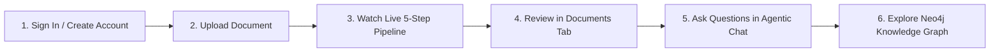

# User Guide

This guide walks you step-by-step through how to interact with the **ADK Agentic RAG + Knowledge Graph** application—from creating an account and uploading documents to monitoring the live 5-step ingestion pipeline, chatting with the AI agent, and exploring your interactive Neo4j Knowledge Graph.

---

## End-to-End User Workflow

---

## Step 1: Sign In or Create an Account

When you open the application in your browser (`http://localhost:5173` in local development), you are greeted by the **Authentication Screen** backed by **Neon Console PostgreSQL**.

### Creating a New Account
1. Click the **Create Account** tab at the top of the card.
2. Fill in your details:
   - **Full Name**: Your display name (for example, `Alice Morgan`). Displayed in the top header bar once signed in.
   - **Email Address**: Your email address (for example, `alice@company.com`).
   - **Password**: A password with at least **6 characters**.
3. Click **Create Account →**.
4. Your account is immediately created in the Neon PostgreSQL `users` table (with a salted `PBKDF2-SHA256` password hash), and you are automatically signed in.

### Signing In with an Existing Account
1. Select the **Sign In** tab.
2. Enter your registered **Email Address** and **Password**.
3. Click **Sign In →**.

> [!NOTE]
> **Strict User Isolation:** Every document you upload, every vector chunk stored in Neon PostgreSQL, and every entity/relationship extracted into Neo4j is strictly scoped to your authenticated user account. Other users cannot view, search, or modify your documents or knowledge graph.

---

## Step 2: Understanding the Workspace Layout

Once signed in, the workspace consists of two main navigation areas:

### 1. Top Header Bar
Located at the top of the screen, the header displays:
- **Application Title & Subtitle**: *ADK Agentic RAG — Neon pgvector + Neo4j Knowledge Graph*
- **API Status Pill**:
  - **Green dot (`API Ready`)**: The FastAPI backend, Neon PostgreSQL, and Neo4j are reachable.
  - **Red dot (`API Offline`)**: The backend server is unreachable.
- **User Profile Pill**: Shows your **Full Name** and **Email Address**.
- **Sign Out Button**: Click **Sign Out** at any time to clear your session token and return to the Sign In screen.

### 2. Five-Tab Navigation Bar
Below the header, five tabs organize your workflow in logical order:

| Tab Order | Tab Name | Purpose |
|-----------|----------|---------|
| **1** | **Upload** | Select or drag-and-drop files to ingest into your workspace. |
| **2** | **Ingestion Pipeline** | Watch real-time step-by-step progress across all 5 ingestion stages and view database metrics. |
| **3** | **Documents** | View all ingested files, check chunk/entity/relationship counts, or cascade-delete files. |
| **4** | **Agentic Chat** | Ask natural-language questions answered by the Google ADK agent using hybrid vector + graph tools. |
| **5** | **Knowledge Graph** | Visually explore extracted Neo4j entities and factual relationships on an interactive canvas. |

---

## Step 3: Uploading a Document (`Upload` Tab)

1. Navigate to the **Upload** tab (selected by default when you sign in).
2. **Select a File**:
   - **Drag and drop** a file directly onto the dashed drop zone, **or**
   - Click anywhere inside the drop zone to open your system file browser.
   - **Supported Formats**: `.pdf`, `.docx`, `.xlsx`, `.xls`, `.pptx`, `.txt`, `.md`, `.csv`, `.json`, `.xml`, `.html`, `.log`.
3. Once a file is selected, the drop zone displays:
   - The **file name**
   - The **file size** in KB
   - A **Remove file** button if you wish to pick a different file
4. Click **Upload & Ingest into Vector + Graph**.
5. **Automatic Redirection**: As soon as the upload begins, the application automatically switches you to the **Ingestion Pipeline** tab so you can watch each stage of the pipeline execute in real time.

---

## Step 4: Monitoring Live Progress (`Ingestion Pipeline` Tab)

The **Ingestion Pipeline** tab provides complete visibility into how your document is processed and stored across **Neon PostgreSQL** and **Neo4j**.

### Understanding the Live 5-Step Progress Indicators

While a document is being ingested, only the **currently executing step** spins/rotates, making it clear what the system is doing at any given moment:

| Visual State | Badge | Meaning |
|--------------|-------|---------|
| **Checkmark (`✓`)** | `Completed` (Green) | This stage has finished for your current document. |
| **Spinning Ring** | `In Progress...` (Blue) | This is the exact stage currently executing on the server. |
| **Numbered Badge (`03`)** | `Queued` (Grey) | This stage is waiting for the current step to finish. |

### What Happens in Each of the 5 Steps

1. **Step 01 — Format-Specific Text Extraction (`parsers.py`)**:
   - Extracts clean text from your uploaded file (PyMuPDF for PDFs, `python-docx` for Word, `openpyxl` for Excel, `python-pptx` for PowerPoint, or UTF-8 text readers).
   - Displays the total character count extracted once complete.
2. **Step 02 — Structure-Aware Semantic Chunking (`chunking.py`)**:
   - Splits the text along natural markdown headers, paragraphs, and sentence boundaries (`1200` characters per chunk with a `200`-character sliding overlap).
   - Displays the exact number of semantic chunks created.
3. **Step 03 — Gemini Embedding Generation (`embeddings.py`)**:
   - Calls `gemini-embedding-001` in batches to generate `768`-dimensional semantic vectors for every chunk.
4. **Step 04 — Neon PostgreSQL Indexing (`rag_store.py`)**:
   - Stores the document metadata, text chunks, `VECTOR(768)` embeddings (indexed via `pgvector` HNSW), and `tsvector` full-text index (GIN) inside Neon PostgreSQL.
5. **Step 05 — Neo4j Knowledge Graph Extraction (`graph_store.py`)**:
   - Uses `gemini-2.5-flash` with Structured Outputs to extract key domain entities (`Person`, `Organization`, `Technology`, `Concept`, `Location`, `Event`, `Process`, `Metric`, `Model`) and factual relationships (`RELATES_TO`), then merges them into Neo4j.

### Pipeline Completion Summary
When all 5 steps finish, a green **All 5 Pipeline Steps Completed Successfully** banner appears at the top of the tab displaying:
- **File**: Name of the ingested document
- **Text Length**: Total characters extracted
- **Vector Chunks**: Number of chunks stored in Neon PostgreSQL
- **Graph Entities**: Number of entities extracted into Neo4j
- **Relationships**: Number of factual links stored in Neo4j

You will also see live summary metric cards at the top of the tab showing your workspace's total **Documents**, **Vector Chunks**, **Graph Entities**, and **Graph Relations**.

---

## Step 5: Managing Your Documents (`Documents` Tab)

Click the **Documents** tab to inspect or clean up your ingested files.

1. **Review Document Metadata**:
   Each document row displays:
   - **File Name** and file type icon
   - **Ingestion Timestamp**
   - **Chunks Badge**: Number of vector chunks in Neon PostgreSQL
   - **Entities Badge**: Number of nodes extracted into Neo4j
   - **Relations Badge**: Number of relationships extracted into Neo4j
2. **Refreshing the List**:
   Click the **↻ Refresh** button in the top-right corner of the card to reload the latest document statistics.
3. **Deleting a Document (Cascade Delete)**:
   - Click the **Delete** button (trash icon) on the right side of a document row.
   - Confirm the deletion in the dialog prompt.
   - **What gets deleted**: The backend performs a **cascade deletion** across both databases—removing the document and all its vector chunks from **Neon PostgreSQL**, detaching its `MENTIONED_IN` links and `RELATES_TO` edges in **Neo4j**, and pruning any orphaned entity nodes that belong solely to that document.

---

## Step 6: Asking Questions (`Agentic Chat` Tab)

Click the **Agentic Chat** tab to converse with the **Google ADK (`LlmAgent`)** assistant over your ingested knowledge base.

### Starting a Conversation
1. **Use a Suggested Prompt** (on an empty chat screen):
   Click any of the starter prompt chips (such as *"Summarize the key topics across my documents"* or *"How are the main entities and technologies connected?"*) to immediately send that question.
2. **Type Your Own Question**:
   - Click the text input box at the bottom of the screen.
   - Type your question (press `Enter` to send, or `Shift + Enter` to insert a new line).
   - Click the **Send** button.

### Understanding How the Agent Answers
Unlike basic RAG systems that only perform a single vector lookup, the ADK Agent dynamically selects and combines **4 specialized retrieval tools** depending on your question:

| Tool Badge Shown in UI | When the Agent Uses It |
|------------------------|------------------------|
| `hybrid_search` | Default tool for general questions, technical terms, names, and numbers. Combines semantic vector similarity (`70%`) with PostgreSQL full-text keyword matching (`30%`). |
| `vector_search` | Used for broad conceptual or thematic questions where exact keywords may not appear verbatim. |
| `graph_search` | Used when you ask about entities, organizations, architectures, or factual connections stored in Neo4j. |
| `get_entity_relationships` | Used when you ask how a specific entity connects to other concepts (multi-hop graph traversal in Neo4j). |

### Reading Tool Badges & Citations in Responses
Every assistant response includes:
1. **Tool Execution Badges** (at the top of the message bubble): Displays which tools the agent called to answer your question (e.g., `hybrid_search` + `graph_search`).
2. **Inline Source Citations**:
   - **Vector/Hybrid Chunk Citations**: Rendered as `[Source: filename.pdf, chunk 2]` so you know the exact document and section where the passage came from.
   - **Knowledge Graph Citations**: Rendered as `[Graph: EntityA -> RELATION_TYPE -> EntityB]` so you can verify factual relationships extracted from the Neo4j graph.

### Starting a Fresh Conversation
Click the **New Session** button in the top-right corner of the chat header to clear the current conversation history and start a fresh multi-turn session with the agent.

---

## Step 7: Exploring the Knowledge Graph (`Knowledge Graph` Tab)

Click the **Knowledge Graph** tab to visually inspect the entities and relationships extracted from your documents into **Neo4j**.

### 1. Graph Overview & Controls Bar
At the top of the Knowledge Graph tab, you can:
- **Search Entities or Facts**: Type a keyword in the search box (for example, `Gemini` or `PostgreSQL`) to filter the visible graph nodes and relationships in real time.
- **Filter by Entity Category**: Click any category pill (`All`, `Technology`, `Concept`, `Organization`, `Person`, `Model`, `Metric`, `Process`, `Location`, `Event`) to isolate nodes of that category.
- **Zoom Controls**: Use the **`+`** (Zoom In), **`-`** (Zoom Out), and **`Reset`** buttons to adjust your view of the SVG network diagram.
- **Refresh**: Click **↻ Refresh** to fetch the latest graph nodes and edges from Neo4j.

### 2. Interacting with the Visual Network Canvas
- **Color-Coded Nodes**: Each circular node represents an extracted `Entity` colored by its category (for example, Indigo for `Technology`, Teal for `Concept`, Amber for `Organization`, Pink for `Person`).
- **Directed Edges (`RELATES_TO`)**: Lines connecting nodes display the relationship label (such as `USES`, `INTEGRATES_WITH`, `DEPENDS_ON`).
- **Inspecting a Node (1-Hop Neighborhood)**:
  1. **Click any node** on the canvas.
  2. The canvas highlights that node and all its direct neighbors while dimming unrelated nodes.
  3. The **Entity Inspector Drawer** on the right displays:
     - The entity's **Name**, **Category Badge**, and **Description**
     - All **Outgoing Relationships** (`Selected Entity -> RELATION -> Target Entity` + supporting fact description)
     - All **Incoming Relationships** (`Source Entity -> RELATION -> Selected Entity` + supporting fact description)
  4. Click any connected entity inside the inspector drawer to jump directly to that entity in the graph.

### 3. Extracted Triplets Table
Below the visual canvas, the **Extracted Knowledge Graph Triplets** table lists every factual relationship in structured form (`Source Entity`, `Relationship Type`, `Target Entity`, and `Supporting Fact`), allowing you to audit the exact facts discovered across your uploaded documents.
