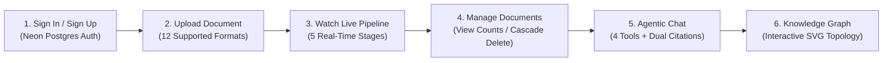

# :material-book-open-page-variant: Interactive User Guide

This step-by-step guide walks you through every screen and interaction in the **ADK Agentic RAG + Knowledge Graph** platform—from signing in with **Neon PostgreSQL Authentication** to monitoring the live 5-step ingestion pipeline, querying the **Google ADK Agent**, and exploring your interactive **Neo4j Knowledge Graph**.

---

## :material-map-marker-path: User Journey Overview

-   :material-shield-account:{ .lg .middle } **Step 1 — Authenticate**

    ---

    Sign in or register an isolated workspace backed by Neon PostgreSQL & JWT tokens.

    [:octicons-arrow-down-24: Jump to Step 1](#step-1-create-an-account-or-sign-in)

-   :material-cloud-upload:{ .lg .middle } **Step 2 & 3 — Upload & Ingest**

    ---

    Drag and drop files and watch each of the 5 pipeline stages execute live.

    [:octicons-arrow-down-24: Jump to Step 3](#step-3-uploading-a-document)

-   :material-forum:{ .lg .middle } **Step 5 — Agentic Chat**

    ---

    Ask complex questions with tool execution badges and `[Source]` / `[Graph]` citations.

    [:octicons-arrow-down-24: Jump to Step 5](#step-5-asking-questions-in-agentic-chat)

-   :material-graph:{ .lg .middle } **Step 6 — Knowledge Graph**

    ---

    Filter entity categories and click nodes to inspect 1-hop relationships.

    [:octicons-arrow-down-24: Jump to Step 6](#step-6-exploring-the-neo4j-knowledge-graph)

---

## Step 1: Create an Account or Sign In

When you open the application (`http://localhost:5173`), the **Bioluminescent Neural Forest Authentication Screen** appears in front of the Tree of Knowledge backdrop.

=== ":material-account-plus: Create a New Account"

    1. Click the **Create Account** tab on the authentication card.
    2. Enter your credentials:
       - **Full Name**: Your display name (e.g., `Drona Sharma`), shown in the top navigation bar.
       - **Email Address**: Your email address (e.g., `drona@company.com`).
       - **Password**: At least **6 characters** (hashed with `PBKDF2-HMAC-SHA256` using `260,000` iterations).
    3. Click **Create Account & Continue →**.
    4. Your user record is created in the Neon PostgreSQL `users` table and you are signed in immediately.

=== ":material-login: Sign In to Existing Account"

    1. Select the **Sign In** tab.
    2. Enter your registered **Email Address** and **Password**.
    3. Click **Sign In to Workspace →**.

!!! info "Strict Multi-Tenant Isolation"
    Every document you upload, every vector chunk stored in **Neon PostgreSQL**, and every entity/relationship node created in **Neo4j** is strictly scoped to your authenticated `user_id`. No other user can view or query your workspace data.

---

## Step 2: Navigating the Workspace Header & 5-Tab Bar

Once authenticated, the workspace presents a sticky top header and a 5-tab workflow bar:

| UI Element | Location | What It Shows |
|------------|----------|---------------|
| **API Online / Offline Pill** | Top-Right Header | Real-time connectivity check against `GET /health` (`API Online` in glowing emerald when healthy). |
| **User Profile Badge** | Top-Right Header | Displays your avatar initial, **Full Name**, and **Email Address**. |
| **Sign Out Button** | Top-Right Header | Clears your JWT session token and returns you to the Sign In screen. |
| **5-Tab Navigation Bar** | Below Header | Ordered left-to-right following your natural workflow: **Upload** → **Ingestion Pipeline** → **Documents** → **Agentic Chat** → **Knowledge Graph**. |

---

## Step 3: Uploading a Document

1. Select the **Upload** tab (active by default upon sign-in).
2. **Choose a Document**:
   - **Drag and drop** a file onto the bioluminescent dashed drop zone, **or** click anywhere inside the drop zone to browse your computer.
   - **Supported Formats**: `.pdf`, `.docx`, `.xlsx`, `.xls`, `.pptx`, `.txt`, `.md`, `.csv`, `.json`, `.xml`, `.html`, `.htm`, `.log`.
3. Verify the file preview card showing the **filename** and **file size** (click **Remove** if you want to pick a different file).
4. Click **Ingest into Neon Postgres & Neo4j**.

!!! tip "Automatic Tab Switch"
    As soon as you click **Ingest into Neon Postgres & Neo4j**, the UI automatically switches you to the **Ingestion Pipeline** tab so you can watch the live 5-step execution in real time.

---

## Step 4: Monitoring the Live 5-Step Ingestion Pipeline

In the **Ingestion Pipeline** tab, only the **currently active step** spins/rotates, so you always know the exact operation executing on the backend:

-   :material-check-circle:{ .lg .middle } **`Completed` (Emerald Checkmark)**

    ---

    The stage has finished executing for your document and displays its concrete output (e.g., characters extracted or chunks created).

-   :material-loading:{ .lg .middle } **`Running Now…` (Cyan Spinner)**

    ---

    This is the exact stage currently executing on the FastAPI backend. The top live banner also shows the percentage progress bar.

-   :material-clock-outline:{ .lg .middle } **`Queued` (Muted Badge)**

    ---

    Upcoming stages waiting for the active step to finish.

### What Happens in Each Stage

1. **Step 1 — Text Extraction (`parsers.py`)**: Extracts raw text using format-specific parsers (`PyMuPDF`, `python-docx`, `openpyxl`, `python-pptx`, etc.).
2. **Step 2 — Structure-Aware Semantic Chunking (`chunking.py`)**: Preserves headings and paragraphs while splitting text into `1,200`-character chunks with a `200`-character overlap.
3. **Step 3 — Gemini Embedding Generation (`embeddings.py`)**: Embeds chunks in batches using `gemini-embedding-001` (`768` dimensions).
4. **Step 4 — Neon PostgreSQL Vector & Hybrid Storage (`rag_store.py`)**: Bulk-inserts chunks, `VECTOR(768)` embeddings (HNSW index), and `tsvector` full-text index (GIN) into Neon PostgreSQL.
5. **Step 5 — Neo4j Knowledge Graph Extraction (`graph_store.py`)**: Uses `gemini-2.5-flash` Structured Outputs to extract domain entities and factual relationships and merges them into Neo4j.

!!! success "Completion Summary Banner"
    When all 5 stages complete, an emerald banner titled **All 5 Pipeline Steps Completed Successfully** displays the **Filename**, **Chunks (pgvector)**, **Entities (Neo4j)**, **Relationships (Neo4j)**, and **Characters** extracted.

---

## Step 5: Managing Your Documents (`Documents` Tab)

Switch to the **Documents** tab to view or delete files in your workspace:

- **Per-Document Badges**: Each document card shows its **chunks** count (in Neon Postgres), **entities** count (in Neo4j), and **relations** count (in Neo4j).
- **Cascade Delete**:
  1. Click **Delete** on any document card.
  2. Click **Yes, delete** on the confirmation prompt (`Delete from Postgres & Neo4j?`).
  3. The backend atomically removes the document and its vector chunks from **Neon PostgreSQL**, deletes its `RELATES_TO` edges and `Document` node in **Neo4j**, and prunes any orphaned entity nodes.

---

## Step 6: Asking Questions in Agentic Chat (`Agentic Chat` Tab)

Switch to the **Agentic Chat** tab to query your documents using the **Google ADK `LlmAgent`**.

1. **Click a Suggested Question Chip** on the starter screen, **or** type your question in the input box at the bottom.
2. Press ++enter++ to send (or ++shift+enter++ to insert a newline).

### Understanding Tool Badges & Dual Citations

The ADK agent autonomously selects one or more of its 4 specialized tools and displays **Tool Execution Badges** at the top of its reply:

| Tool Badge | Database Queried | When the Agent Chooses It |
|------------|------------------|---------------------------|
| `hybrid_search` | Neon PostgreSQL (`pgvector` + FTS) | Default for most questions; combines `70%` semantic similarity + `30%` keyword matching. |
| `vector_search` | Neon PostgreSQL (`pgvector`) | Broad conceptual or thematic questions. |
| `graph_search` | Neo4j Knowledge Graph | Questions about entities, technologies, people, or how concepts connect. |
| `get_entity_relationships` | Neo4j Knowledge Graph | Deep-dive traversal into a specific entity's 1-hop neighborhood. |

Every assistant response includes inline verifiable citations:
- **Document Chunk Citation**: `[Source: filename.pdf, chunk 3]` (highlighted in emerald)
- **Knowledge Graph Citation**: `[Graph: Google ADK -> USES -> Gemini 2.5 Pro]` (highlighted in gold)

---

## Step 7: Exploring the Neo4j Knowledge Graph (`Knowledge Graph` Tab)

Switch to the **Knowledge Graph** tab to visually explore the entities and relationships extracted from your documents:

1. **Filter by Category Pills**: Click `All`, `Technology`, `Model`, `Concept`, `Organization`, `Person`, `Metric`, `Location`, or `Event` to isolate specific node types.
2. **Real-Time Search**: Type any keyword into the filter bar to highlight matching entities, relationship types, or facts.
3. **Interactive SVG Topology**:
   - **Click any node** on the glowing neural canvas to highlight its 1-hop neighborhood and inspect its description and relationships in the right-hand **Entity Inspector** panel.
   - Click any entity name in the **Extracted Relationship Facts** list on the right to center and select that node on the graph.
   - Click **Clear** on the selected entity card to return to the full graph view.
