# :material-book-open-page-variant: Interactive User Guide

This step-by-step visual guide walks you through **each and every screen and interactive state** of the **ADK Agentic RAG + Knowledge Graph** platform—from signing in with **Neon PostgreSQL Authentication** to uploading documents, monitoring the live 5-step hybrid ingestion pipeline, managing indexed documents, querying the **Google ADK Agent**, and inspecting your **Neo4j Knowledge Graph**.

---

## :material-map-marker-path: End-to-End Application Screen Map

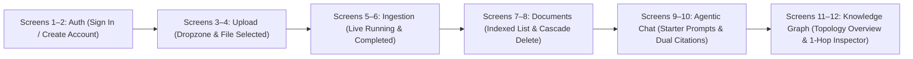

-   :material-shield-account:{ .lg .middle } **Screens 1 & 2 — Authentication**

    ---

    Sign in or register an isolated multi-tenant workspace backed by **Neon PostgreSQL** (`PBKDF2-HMAC-SHA256` + `HS256` JWT).

    [:octicons-arrow-down-24: View Screens 1 & 2](#step-1-create-an-account-or-sign-in)

-   :material-cloud-upload:{ .lg .middle } **Screens 3 & 4 — Document Upload**

    ---

    Drag and drop files across 13 supported formats, preview file metadata, and launch hybrid ingestion.

    [:octicons-arrow-down-24: View Screens 3 & 4](#step-2-uploading-a-document)

-   :material-progress-check:{ .lg .middle } **Screens 5 & 6 — Live 5-Step Pipeline**

    ---

    Watch real-time step-by-step execution across text extraction, chunking, Gemini embeddings, Neon `pgvector`, and Neo4j.

    [:octicons-arrow-down-24: View Screens 5 & 6](#step-3-monitoring-the-live-5-step-ingestion-pipeline)

-   :material-folder-multiple-outline:{ .lg .middle } **Screens 7 & 8 — Document Management**

    ---

    Inspect per-document vector chunk, entity, and relationship counts or trigger atomic cascade deletion across both databases.

    [:octicons-arrow-down-24: View Screens 7 & 8](#step-4-managing-indexed-documents-documents-tab)

-   :material-forum:{ .lg .middle } **Screens 9 & 10 — Agentic Chat**

    ---

    Query the **Google ADK `LlmAgent`** with autonomous tool selection (`hybrid_search`, `graph_search`) and `[Source]` / `[Graph]` citations.

    [:octicons-arrow-down-24: View Screens 9 & 10](#step-5-asking-questions-in-agentic-chat-agentic-chat-tab)

-   :material-graph:{ .lg .middle } **Screens 11 & 12 — Knowledge Graph**

    ---

    Explore the interactive Neo4j SVG entity topology, filter by category, and click any node to inspect its 1-hop neighborhood.

    [:octicons-arrow-down-24: View Screens 11 & 12](#step-6-exploring-the-neo4j-knowledge-graph-knowledge-graph-tab)

---

## Step 1: Create an Account or Sign In

When you open the application (`http://localhost:5173`), the **Bioluminescent Neural Forest Authentication Screen** appears in front of the Tree of Knowledge backdrop. Every account is stored in the **Neon PostgreSQL `users` table** and issues an `HS256` signed JWT Bearer token.

### Screen 1 — Sign In to Existing Workspace

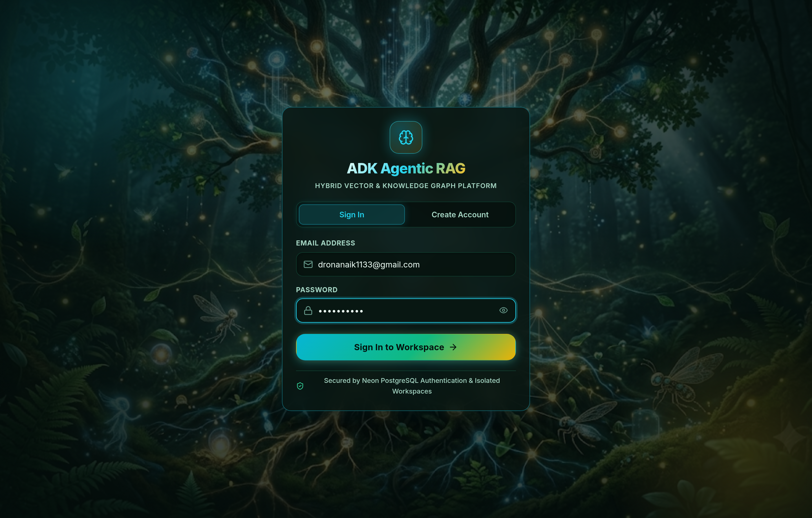

1. Select the **Sign In** tab on the authentication modal.
2. Enter your registered **Email Address** (e.g., `dronanaik1133@gmail.com`) and **Password**.
3. Click **Sign In to Workspace →** to authenticate against `POST /auth/login` and enter your isolated workspace.

---

### Screen 2 — Create a New Account

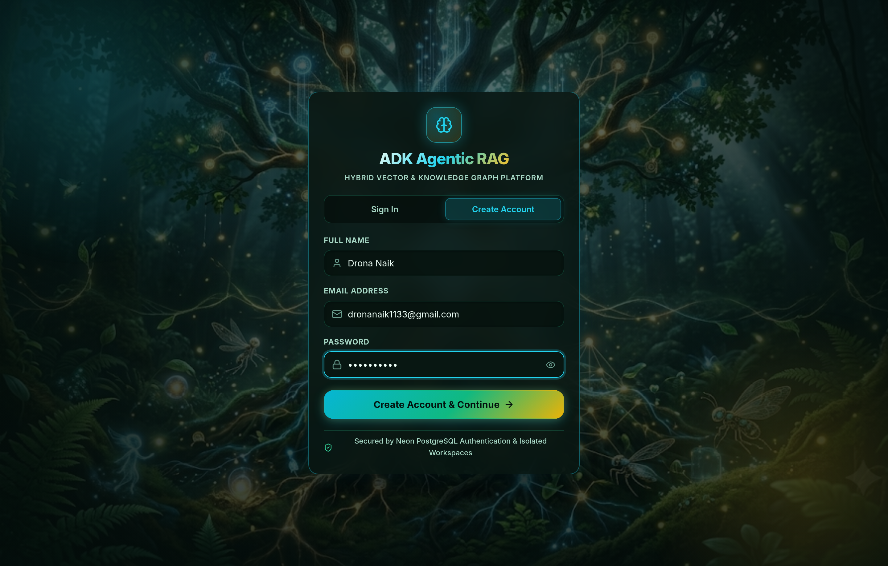

1. Select the **Create Account** tab on the authentication card.
2. Fill in your registration details:
   - **Full Name**: Your display name shown in the top workspace header.
   - **Email Address**: Your unique workspace identifier (`user_id`).
   - **Password**: Minimum 6 characters, hashed using `PBKDF2-HMAC-SHA256` before storage in Neon PostgreSQL.
3. Click **Create Account & Continue →** to register via `POST /auth/signup` and automatically sign in.

!!! info "Strict Multi-Tenant Data Isolation"
    Every document you upload, every `768`-dimensional vector chunk stored in **Neon PostgreSQL**, and every `:Entity` / `:RELATES_TO` record created in **Neo4j** is strictly scoped to your authenticated `user_id`. No other user can view or query your workspace data.

---

## Step 2: Uploading a Document (`Upload` Tab)

Once signed in, the top header displays your **API Online** health indicator, your **User Profile Badge**, the **Sign Out** button, and the **5-Tab Navigation Bar** (**Upload** → **Ingestion Pipeline** → **Documents** → **Agentic Chat** → **Knowledge Graph**).

### Screen 3 — Upload Document Dropzone (Empty State)

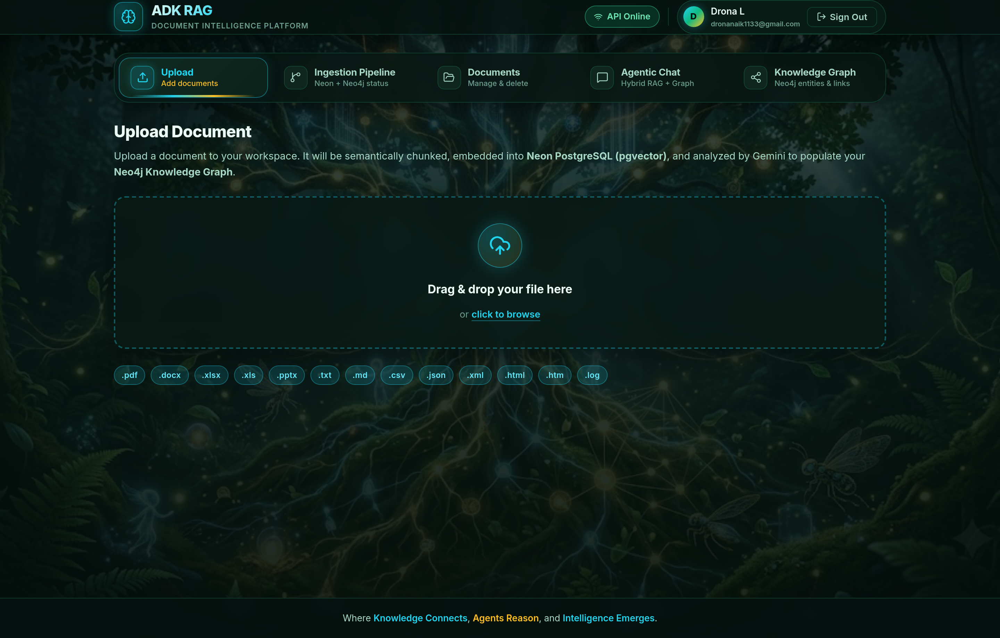

1. The **Upload** tab is active by default when you sign in.
2. Drag and drop a file onto the dashed bioluminescent dropzone, or click **click to browse** to open your system file picker.
3. All **13 supported file extensions** are displayed as badges below the dropzone: `.pdf`, `.docx`, `.xlsx`, `.xls`, `.pptx`, `.txt`, `.md`, `.csv`, `.json`, `.xml`, `.html`, `.htm`, and `.log`.

---

### Screen 4 — Document Selected & Ready to Ingest

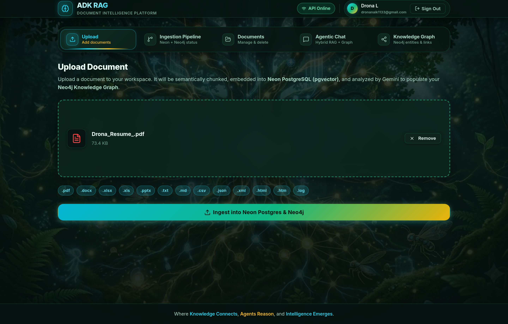

1. Once a file is selected (e.g., `Drona_Resume_.pdf` — `73.4 KB`), the dropzone transforms into a **File Preview Card** displaying:
   - Format-specific file icon (red PDF badge for `.pdf` files)
   - Exact **filename** and formatted **file size**
   - A **× Remove** button if you want to clear the selection and pick a different file
2. Click the primary gradient button **Ingest into Neon Postgres & Neo4j** at the bottom of the screen to launch the 5-step hybrid ingestion pipeline.

---

## Step 3: Monitoring the Live 5-Step Ingestion Pipeline (`Ingestion Pipeline` Tab)

Clicking **Ingest into Neon Postgres & Neo4j** automatically transitions you to the **Ingestion Pipeline** tab (`IngestionTab.jsx`), which polls `GET /ingest/progress` every `450ms` to display real-time execution progress.

### Screen 5 — Live 5-Step Hybrid Ingestion Pipeline (Running State)

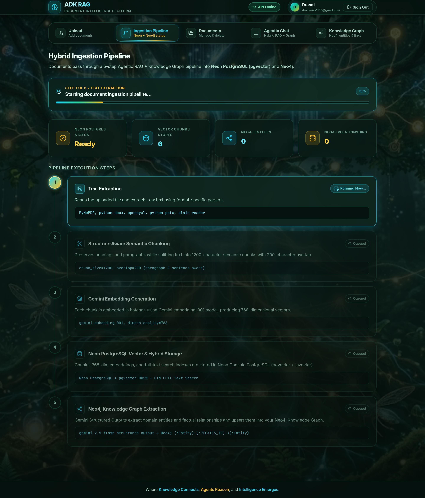

While a document is actively being processed:

- **Top Live Progress Banner**: Displays the active step number (`STEP 1 OF 5 • TEXT EXTRACTION`), live status message (`Starting document ingestion pipeline...`), percentage badge (`15%`), and animated progress bar.
- **Database Status Cards**: Real-time counters for **Neon Postgres Status** (`Ready`), **Vector Chunks Stored**, **Neo4j Entities**, and **Neo4j Relationships**.
- **Active vs. Queued Step Badges**:
  - The currently executing stage highlights with a glowing cyan border and a **`Running Now...`** spinner badge.
  - Upcoming stages remain in the **`Queued`** state until the active stage completes.

---

### Screen 6 — All 5 Pipeline Steps Completed Successfully

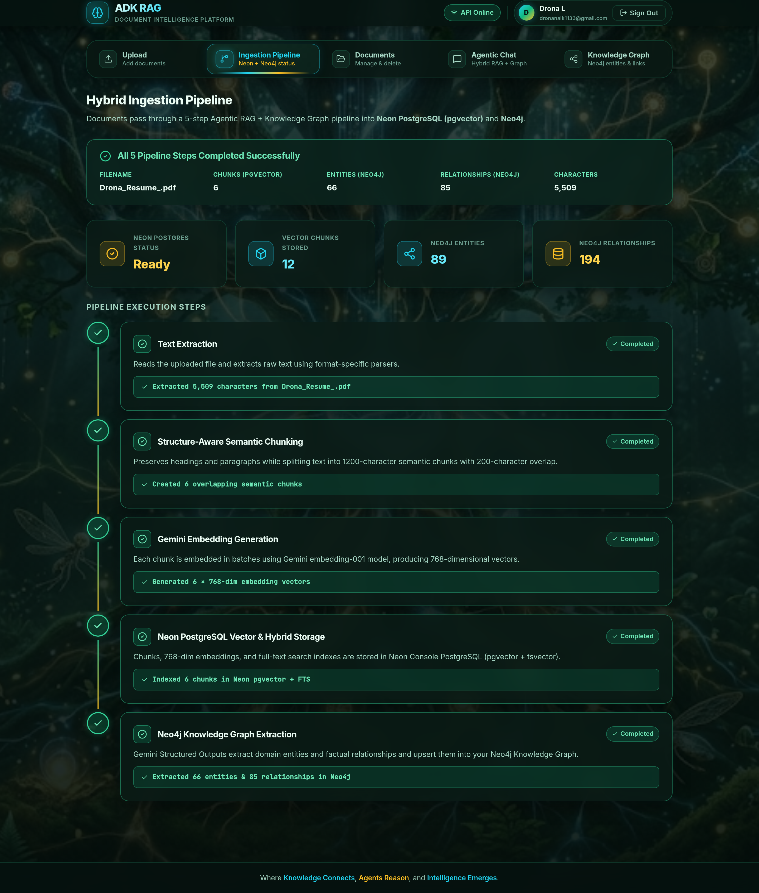

When all 5 stages finish executing:

1. **Emerald Completion Banner (`All 5 Pipeline Steps Completed Successfully`)**: Summarizes the exact ingestion metrics for your file:
   - **Filename**: `Drona_Resume_.pdf`
   - **Chunks (pgvector)**: `6`
   - **Entities (Neo4j)**: `66`
   - **Relationships (Neo4j)**: `85`
   - **Characters**: `5,509`
2. **Updated Database Counters**: The 4 workspace metric cards immediately reflect the updated totals in Neon PostgreSQL and Neo4j.
3. **Per-Stage Output Logs**: All 5 pipeline cards show green **`✓ Completed`** badges along with their concrete stage output:
   - **Step 1 — Text Extraction**: `✓ Extracted 5,509 characters from Drona_Resume_.pdf`
   - **Step 2 — Structure-Aware Semantic Chunking**: `✓ Created 6 overlapping semantic chunks`
   - **Step 3 — Gemini Embedding Generation**: `✓ Generated 6 × 768-dim embedding vectors`
   - **Step 4 — Neon PostgreSQL Vector & Hybrid Storage**: `✓ Indexed 6 chunks in Neon pgvector + FTS`
   - **Step 5 — Neo4j Knowledge Graph Extraction**: `✓ Extracted 66 entities & 85 relationships in Neo4j`

---

## Step 4: Managing Indexed Documents (`Documents` Tab)

Switch to the **Documents** tab (`DocumentsTab.jsx`) to audit your indexed files or remove documents from your workspace.

### Screen 7 — My Documents List View

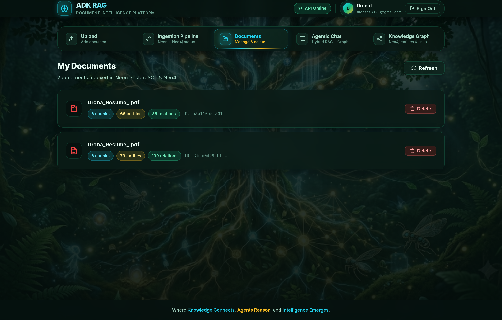

Each indexed document card displays:

- **Filename & Format Icon**: e.g., `Drona_Resume_.pdf`
- **Neon PostgreSQL Vector Count Badge**: `6 chunks` (cyan badge)
- **Neo4j Entity Count Badge**: `66 entities` (gold badge)
- **Neo4j Relationship Count Badge**: `85 relations` (emerald badge)
- **Document UUID**: Truncated `doc_id` (`ID: a3b110e5-301...`)
- **Refresh & Delete Controls**: Top-right **Refresh** button and per-document **Delete** button.

---

### Screen 8 — Cascade Delete Confirmation State

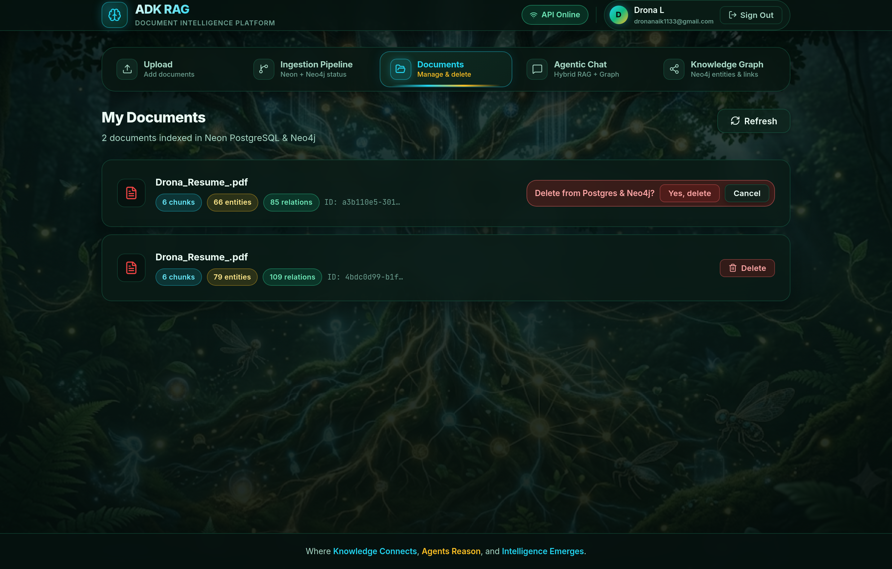

1. Clicking **Delete** on any document card reveals an inline confirmation bar: **`Delete from Postgres & Neo4j?`** with **Yes, delete** and **Cancel** buttons.
2. Clicking **Yes, delete** invokes `DELETE /documents/{doc_id}`, which atomically:
   - Deletes the document metadata row and all associated `document_chunks` (`ON DELETE CASCADE`) from **Neon PostgreSQL**.
   - Removes all `RELATES_TO` edges, the `:Document` node, and any orphaned `:Entity` nodes for that document from **Neo4j**.
3. Clicking **Cancel** dismisses the confirmation prompt without modifying your data.

---

## Step 5: Asking Questions in Agentic Chat (`Agentic Chat` Tab)

Switch to the **Agentic Chat** tab (`ChatTab.jsx`) to converse with the **Google ADK `LlmAgent`** powered by **Gemini 2.5 Pro**.

### Screen 9 — Agentic Chat Starter Prompts (Empty State)

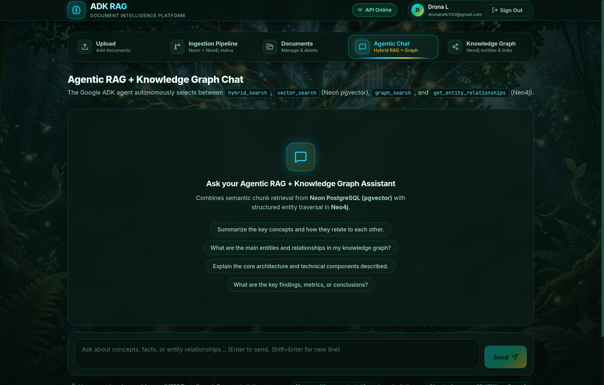

When starting a new session:

- Four clickable **Starter Question Pills** let you immediately test hybrid vector + graph retrieval:
  1. *"Summarize the key concepts and how they relate to each other."*
  2. *"What are the main entities and relationships in my knowledge graph?"*
  3. *"Explain the core architecture and technical components described."*
  4. *"What are the key findings, metrics, or conclusions?"*
- You can also type any custom question into the bottom input box and press ++enter++ (or click **Send**).

---

### Screen 10 — Multi-Tool Agentic Response with Dual Citations

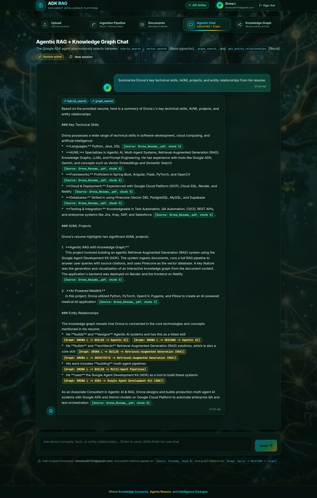

When you submit a question (e.g., *"Summarize Drona's key technical skills, AI/ML projects, and entity relationships from his resume."*):

1. **Session Management Controls**: The header displays a glowing **`Session active`** badge (preserving multi-turn ADK `InMemorySessionService` memory) and a **`New session`** button to reset the conversation.
2. **Tool Execution Badges**: At the top of the assistant bubble, tool chips show the exact backend tools the ADK agent autonomously executed (`hybrid_search`, `graph_search`, `get_entity_relationships`, or `vector_search`).
3. **Inline Dual Citations**:
   - **Document Chunk Citations** (`[Source: Drona_Resume_.pdf, chunk N]`) highlight in **cyan/emerald**, linking claims directly to semantic vector chunks in **Neon PostgreSQL**.
   - **Knowledge Graph Citations** (`[Graph: DRONA L -> BUILDS -> Agentic AI]`, `[Graph: DRONA L -> ARCHITECTS -> Retrieval-Augmented Generation (RAG)]`, `[Graph: DRONA L -> USES -> Google Agent Development Kit (ADK)]`) highlight in **gold**, tracing multi-hop entity relationships in **Neo4j**.

---

## Step 6: Exploring the Neo4j Knowledge Graph (`Knowledge Graph` Tab)

Switch to the **Knowledge Graph** tab (`GraphTab.jsx`) to visually explore and query the domain entities and directed relationships extracted from your documents.

### Screen 11 — Neo4j Knowledge Graph Topology Overview

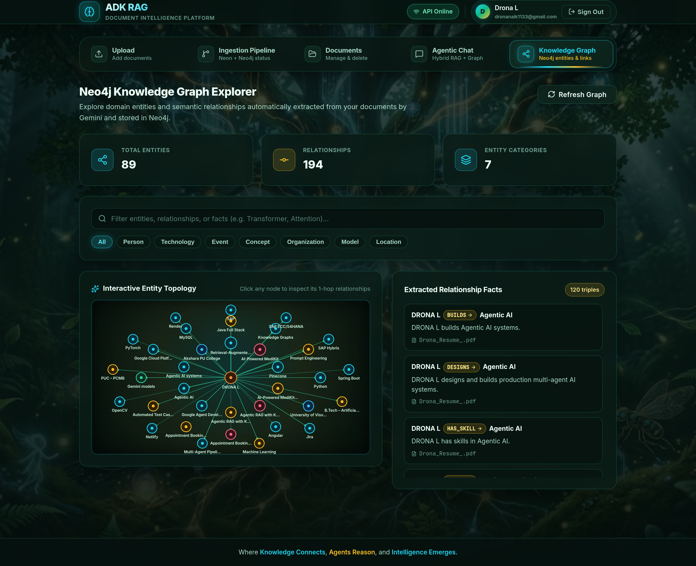

The **Neo4j Knowledge Graph Explorer** provides four synchronized views:

1. **Graph Summary Cards**: Displays **Total Entities** (`89`), **Relationships** (`194`), and **Entity Categories** (`7`).
2. **Real-Time Search & Category Filter Pills**:
   - Type any keyword into the search bar to filter entities, relationship types, or facts in real time.
   - Click any category pill (`All`, `Person`, `Technology`, `Event`, `Concept`, `Organization`, `Model`, `Location`) to isolate specific node types.
3. **Interactive Entity Topology (Left Panel)**: Renders a radial SVG neural network where hub entities (such as `DRONA L`) sit at the center connected to surrounding technology, model, and organization nodes color-coded by category.
4. **Extracted Relationship Facts (Right Panel)**: Lists all extracted `(Source) -[RELATION]-> (Target)` triples (e.g., `DRONA L [BUILDS ->] Agentic AI`) along with their natural-language fact sentence and source document attribution (`Drona_Resume_.pdf`).

---

### Screen 12 — Selected Entity 1-Hop Neighborhood Inspector

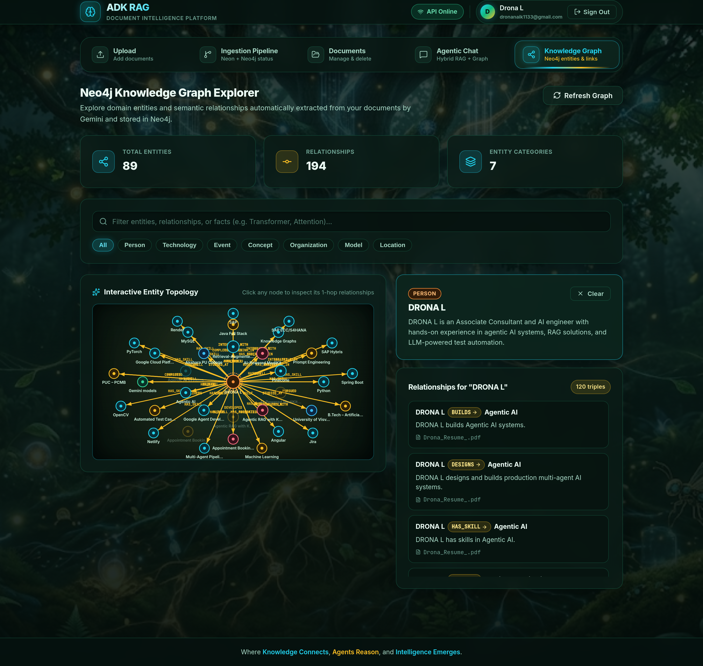

Clicking any node on the interactive SVG canvas (or clicking any entity name in the right-hand facts list) activates the **1-Hop Neighborhood Inspector**:

1. **Gold Neighborhood Highlighting**: All edges directly connected to the selected entity (`DRONA L`) illuminate in gold (`#fbbf24`) with relationship labels (`BUILDS`, `DESIGNS`, `HAS_SKILL`, `USES`, `DEVELOPED`, `STUDIED_AT`) rendered along the connecting paths, while unconnected nodes dim.
2. **Selected Entity Detail Card (Top-Right)**: Displays the entity's category badge (`PERSON`), canonical name (`DRONA L`), Gemini-extracted summary description (*"DRONA L is an Associate Consultant and AI engineer with hands-on experience in agentic AI systems, RAG solutions, and LLM-powered test automation."*), and a **`× Clear`** button to return to the full graph view.
3. **Filtered Entity Relationships List (Bottom-Right)**: Automatically filters the right-hand panel (`Relationships for "DRONA L"`) to show only the relationship triples involving the selected node.
