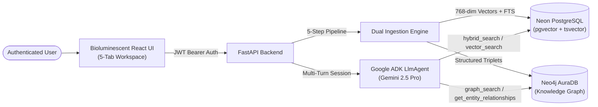

---
hide:
  - navigation
---

<div class="adk-hero" markdown="1">

<div class="adk-hero-badge" markdown="1">
:material-sparkles: Google ADK &bull; Gemini 2.5 &bull; Neon pgvector &bull; Neo4j
</div>

# ADK Agentic RAG + Knowledge Graph

<div class="adk-hero-tagline" markdown="1">
"Where Knowledge Connects, Agents Reason, and Intelligence Emerges."
</div>

An enterprise-ready **Hybrid Document Intelligence Platform** built with **Google Agent Development Kit (ADK)**. Authenticate with **Neon PostgreSQL**, ingest documents through a live 5-step dual vector + graph pipeline, explore interactive **Neo4j** knowledge topologies, and converse with a multi-tool reasoning agent.

<div class="adk-hero-actions" markdown="1">

[:material-rocket-launch: Quickstart Guide](INSTALLATION.md){ .adk-btn-primary }
[:material-book-open-page-variant: Interactive User Guide](USER_GUIDE.md){ .adk-btn-secondary }
[:material-sitemap: System Architecture](ARCHITECTURE.md){ .adk-btn-secondary }
[:material-file-cog: Technical Specs](TECHNICAL_SPECIFICATIONS.md){ .adk-btn-secondary }

</div>

</div>

## :material-compass-outline: Explore the Platform

<div class="grid cards" markdown>

-   :material-book-open-variant:{ .lg .middle } **Interactive User Guide**

    ---

    Step-by-step walkthrough of every screen: Neon authentication, drag-and-drop file upload, live 5-step pipeline monitoring, Agentic Chat, and Knowledge Graph exploration.

    [:octicons-arrow-right-24: Read User Guide](USER_GUIDE.md)

-   :material-sitemap:{ .lg .middle } **System Architecture**

    ---

    End-to-end architectural diagrams, sequence flows for authentication, dual ingestion, multi-tool ADK retrieval, and multi-tenant data isolation.

    [:octicons-arrow-right-24: Explore Architecture](ARCHITECTURE.md)

-   :material-file-code-outline:{ .lg .middle } **Technical Specifications**

    ---

    Complete engineering specs: Neon `pgvector` HNSW & GIN schemas, Neo4j graph constraints, `PBKDF2-SHA256` + `HS256` JWT security, and hybrid search formulas.

    [:octicons-arrow-right-24: View Technical Specs](TECHNICAL_SPECIFICATIONS.md)

-   :material-pipe:{ .lg .middle } **5-Step Dual Ingestion Pipeline**

    ---

    How documents are parsed, semantically chunked (`1200` chars), batch-embedded (`768`-dim), indexed in Neon Postgres, and extracted into Neo4j triplets.

    [:octicons-arrow-right-24: Pipeline Deep Dive](INGESTION.md)

-   :material-robot-outline:{ .lg .middle } **Agentic Chat & Graph Tools**

    ---

    How the Google ADK `LlmAgent` dynamically orchestrates `hybrid_search`, `vector_search`, `graph_search`, and `get_entity_relationships`.

    [:octicons-arrow-right-24: Agent Tools Guide](CHAT.md)

-   :material-api:{ .lg .middle } **REST API & Cloud Deployment**

    ---

    Complete FastAPI endpoint reference with `curl` examples plus production deployment guides for Render, Netlify, Neon, and Neo4j AuraDB.

    [:octicons-arrow-right-24: View API Reference](API.md)

</div>

---

## :material-layers-triple-outline: Why Hybrid Vector + Knowledge Graph RAG?

Traditional RAG systems rely solely on vector similarity over isolated chunks, often missing global entity relationships or exact technical identifiers. **ADK Agentic RAG** unites three complementary paradigms under a single Google ADK agent:

=== ":material-database-search: Hybrid Search (Neon PostgreSQL)"

    Combines **768-dimensional semantic vector search** (`pgvector` HNSW cosine similarity, `70%` weight) with **PostgreSQL Full-Text Search** (`ts_rank_cd` GIN index, `30%` weight) in a single SQL query—capturing both conceptual meaning and exact keyword/identifier matches.

    ```sql
    SELECT chunk_id, filename, content,
           (1 - (embedding <=> %(query_vec)s::vector)) AS vector_similarity,
           ts_rank_cd(to_tsvector('english', content), plainto_tsquery('english', %(query)s)) AS keyword_score,
           (0.7 * (1 - (embedding <=> %(query_vec)s::vector)) +
            0.3 * ts_rank_cd(to_tsvector('english', content), plainto_tsquery('english', %(query)s))) AS combined_score
    FROM document_chunks
    WHERE user_id = %(user_id)s
    ORDER BY combined_score DESC
    LIMIT 5;
    ```

=== ":material-graph: Knowledge Graph (Neo4j)"

    Uses **Gemini 2.5 Flash Structured Outputs** during ingestion to extract typed domain entities (`Technology`, `Model`, `Organization`, `Person`, `Concept`, `Metric`) and directed `[:RELATES_TO]` facts into **Neo4j**, enabling multi-hop relationship traversal.

    ```cypher
    MATCH (s:Entity {user_id: $user_id})-[r:RELATES_TO {user_id: $user_id}]->(t:Entity {user_id: $user_id})
    WHERE toLower(s.name) CONTAINS $term OR toLower(r.fact) CONTAINS $term
    RETURN s.name AS source, r.relation_type AS relation_type, t.name AS target, r.fact AS fact
    LIMIT 15;
    ```

=== ":material-brain: Google ADK Multi-Tool Agent"

    The `LlmAgent` powered by **Gemini 2.5 Pro** autonomously chooses which tool—or combination of tools—to invoke for each user question, returning inline citations for both document chunks (`[Source: file.pdf, chunk 2]`) and graph facts (`[Graph: EntityA -> USES -> EntityB]`).

    ```python
    root_agent = LlmAgent(
        name="hybrid_rag_kg_agent",
        model=AGENT_MODEL,
        description="Hybrid Vector + Knowledge Graph Agentic RAG assistant.",
        instruction=build_agent_instruction,
        tools=[
            hybrid_search,
            vector_search,
            graph_search,
            get_entity_relationships,
        ],
    )
    ```

---

## :material-transit-connection-variant: End-to-End Architecture at a Glance


